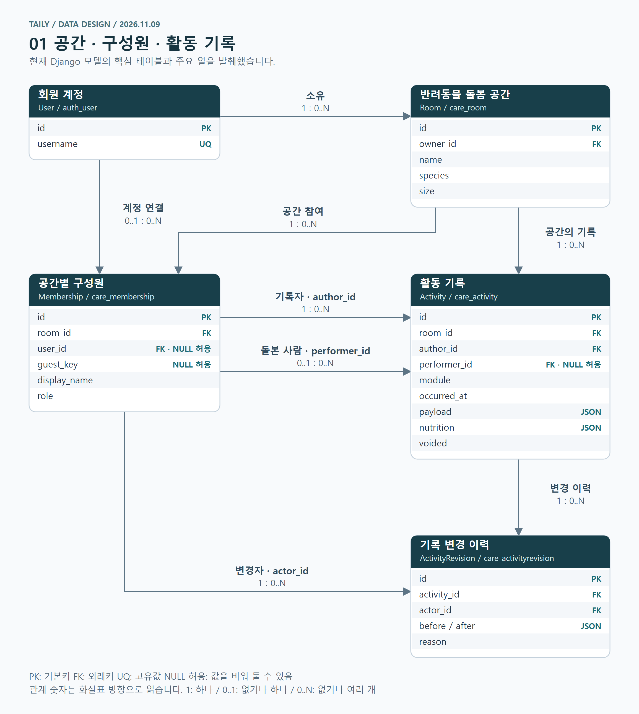
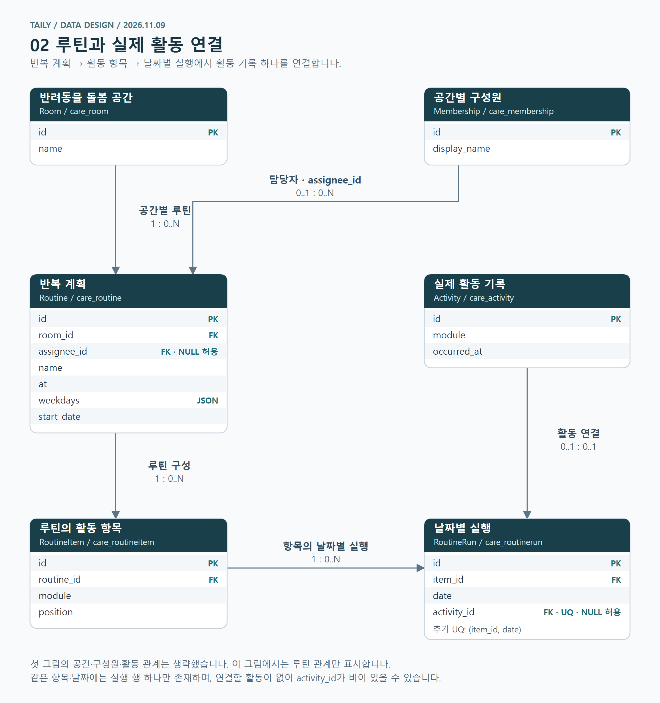

# [구현 02] 돌봄 기록을 실제로 저장하고 함께 사용하는 사이트 만들기

첫 글에서는 누가 쓰는 서비스인지, 어떤 불편을 해결할지, 이번 학기에 어디까지 만들지를 정리했다. 이후 AI와 기능을 더 논의하고 전체가 연결된 첫 버전을 만들었다. 이름은 테일리로 정했다.

우선 한 번에 전체 틀을 만든 다음, 내가 직접 화면을 보면서 이상하거나 부족한 부분을 짚는 방식으로 진행했다. 수정된 화면을 다시 보고 의견을 주는 과정을 반복하면서 현재는 4차 개선까지 왔다. 처음 구현한 내용과 그 뒤에 어떤 부분을 고쳤는지 함께 정리해 보려고 한다.

## 기록을 기준으로 기능을 연결했다

첫 구현에서는 20개 모듈을 준비하고 각각 다른 입력 항목과 통계를 연결했다. 체중은 측정값을, 지출은 금액과 통화를, 재고는 입고·사용·실사 조정을 기록한다.

같은 활동을 모듈과 루틴에 두 번 저장하지 않도록 공통 활동 기록을 중심에 뒀다. 루틴에서 새로 기록하거나 이미 저장한 기록을 연결할 수 있다. 취소하면 집계에서 제외하고 루틴의 완료 표시도 풀리지만 변경 이력은 유지한다.

현재 코드의 주요 테이블을 ERD로 정리하면 아래와 같다. 그림에는 전체 테이블 중 공간, 구성원, 활동 기록과 변경 이력을 골라 넣었다.

*[그림 크게 보기](../assets/data-design/erd-core.png). PK는 각 행을 구분하는 키, FK는 다른 테이블을 참조하는 키다. 관계 숫자는 화살표 방향으로 읽는다. `0..1`은 없거나 하나, `0..N`은 없거나 여러 개를 뜻한다.*

`Room`은 반려동물 한 마리의 돌봄 공간으로, 이름과 종·체격 등의 정보도 여기에 들어간다. 실제 기록은 `Activity`에 모인다. 가족이 산책한 일을 내가 대신 입력할 수도 있어서 기록 작성자와 실제 돌본 사람을 구분한다.

산책 거리나 급여량처럼 활동마다 달라지는 값은 `payload`라는 JSON 필드에 저장한다. 여러 종류의 기록을 같은 구조로 다루기 편하지만, 그 안에 들어갈 값과 단위는 입력·저장 코드에서 검사해야 한다. 제품 식별자도 JSON 안의 값이라 제품 테이블에 직접 연결된 FK는 아니다.

## 로그인과 방 권한을 분리했다

처음 논의할 때 내가 제안한 것은 방을 만든 사람, 그 사람이 권한을 준 로그인한 사람, 초대 링크로 들어온 게스트를 나누는 것이었다. 초대받은 사람은 굳이 가입하지 않아도 기록할 수 있게 하되, 모듈 설정까지 바꾸지는 못하게 하고 싶었다.

AI는 이를 방장·관리자·게스트로 정리했다. 로그인했다고 바로 관리자가 되는 것은 아니고, 방장이 해당 참여자를 관리자로 지정해야 설정을 바꿀 수 있게 했다. 같은 사람도 어느 방에서는 방장이고 다른 방에서는 게스트일 수 있으므로, 계정인 `User`와 공간별 구성원인 `Membership`을 분리했다.

처음에는 게스트에게 어떤 정보를 보여줄지도 정하지 않았다. 구현 과정에서 투약·병원·지출은 기본적으로 방장과 관리자에게만 보이고, 방장이 공유 범위를 바꿀 수 있게 했다. 이 세부 기본값은 구현하면서 정한 부분이다.

## 루틴의 계획과 실제 기록은 따로 둔다

매일 저녁 밥과 산책을 한다는 계획과, 오늘 실제로 밥을 줬다는 기록은 구분할 필요가 있다. 현재는 반복 일정인 `Routine`, 그 안의 활동 항목인 `RoutineItem`, 날짜별 실행인 `RoutineRun`으로 나뉜다.

*[그림 크게 보기](../assets/data-design/erd-routine.png). 앞 그림의 관계는 생략하고 루틴 연결만 표시했다. UQ는 중복을 허용하지 않는 조건이다.*

루틴에서 식사를 기록하면 활동 하나를 만들고 그날의 실행에 연결한다. 식사 화면에서 이미 남긴 기록이 있으면 그 기록을 연결할 수도 있다. 어느 화면에서 시작하더라도 같은 활동을 다시 저장하지 않는 것이다.

같은 항목과 날짜에는 실행 행이 하나만 생기도록 했다. 활동 연결은 비워 둘 수 있지만, 하나의 활동을 여러 실행 행에 연결할 수는 없다. 모듈을 화면에서 빼는 것도 이미 남긴 활동을 삭제하는 것과 구분했다.

## 정상 입력보다 실패·중복·변경 상황이 더 까다로웠다

같은 저장 버튼을 다시 누르거나 두 사람이 동시에 같은 루틴을 완료할 수 있다. 요청 식별자와 DB 제약으로 같은 요청을 한 번만 저장하고, 별개의 활동은 각각 보존하도록 했다. 수정 중 다른 사람이 먼저 바꾼 경우에는 기존 입력이 새 내용을 덮어쓰지 않도록 버전을 비교한다. 변경 전후 내용과 처리한 사람, 이유는 `ActivityRevision`에 남긴다.

이 과정에서 AI가 구현과 검사를 진행하며 발견한 오류도 있었다. 실제 브라우저에서 보안 헤더 때문에 정상 POST 요청이 CSRF 검사에 막혔다. 같은 출처의 요청을 확인할 수 있도록 리퍼러 정책을 수정한 뒤 브라우저 로그인을 다시 검사했다. 모듈 토글도 보이는 스위치와 실제 클릭 영역이 겹치는 문제가 있어 클릭·키보드 조작과 실제 저장을 확인했다.

Windows에서는 백업을 복원할 때 파일 교체가 거부됐다. SQLite 연결의 컨텍스트 관리가 연결 종료까지 보장하는 것은 아니어서, 파일 교체 전에 연결을 명시적으로 닫도록 고치고 별도 저장소에서 복원을 다시 검사했다.

## 통계를 만들 때 단위를 먼저 구분했다

물 보충량은 실제 마신 양과 다르고, 체중을 여러 번 쟀다고 합산할 수는 없다. 다른 통화의 지출도 환율을 가정해서 더하지 않았다. 제품 영양 정보는 기록 당시 값을 보존해 제품을 수정해도 과거 기록의 의미가 갑자기 바뀌지 않도록 했다.

첫 버전의 통합 상태는 현재와 7일 전, 달력 기준 1개월 전을 비교하는 구성이었다. 활동량은 각 기준일까지 최근 7일, 체중은 마지막 측정값, 재고는 기준일 잔량으로 다뤘다. 기록이 없는 것과 실제 값이 0인 것도 구분했다. 다만 이 수치들을 모아 보여주는 것만으로는 내가 생각했던 통합 상태가 되지 않았고, 이후 다시 논의하게 됐다.

## 직접 화면을 보고 고치기 시작했다

첫 화면에서 불편했던 것은 기록할 때 묻는 내용이 너무 많다는 점이었다. 모듈이 하나도 아닌데 각각 세세하게 입력해야 했다. 나는 여러 기능을 쓰면서 매번 보고서를 작성할 만큼의 수고를 사용자가 감수하겠냐고 물었다.

그래서 모듈별로 최소 입력부터 다시 정하도록 했다. 청소·물 교체는 완료 여부, 산책은 시작과 종료, 체중은 측정값처럼 나누고 상세 설명은 필요할 때 펼쳐 쓰는 방향이었다. 이미 알고 있는 기록 시각과 작성자도 매번 묻지 않도록 했다.

청소나 미용처럼 자주 하지 않는 활동이 늘 화면에 나와 있는 것도 지적했다. 기능은 사용하더라도 평소에는 숨기고, 설정한 간격이 됐을 때 보여주면 좋겠다고 했다. 이 의견은 기능 사용 여부, 오늘 화면 고정, 활동 주기를 구분하는 설정으로 이어졌다.

모듈 구성에서는 순서 변경이 기대대로 작동하지 않았다. 내가 원한 동작은 항목을 잡아 움직이면 주변 항목도 밀리면서 들어갈 자리가 보이는 방식이었다. 또 사용 중인 모듈과 추가할 모듈이 한 목록에 섞여 있었다. 왼쪽에는 넣은 모듈, 오른쪽에는 전체 모듈을 두면 적게 쓰는 사람은 자신이 넣은 것만 보고 관리할 수 있겠다고 제안했다.

바로 수정하기 전에 AI에게 내 설명을 정리해 보라고 했다. AI는 왼쪽에서 정렬·제거하고 오른쪽에서 새 기능을 찾는 구조로 이해했다고 답했다. 그 내용을 확인한 뒤 수정 계획에 넣었다.

2차 수정 뒤에도 문제가 남았다. 점 여섯 개로 된 드래그 손잡이가 흐릿했고, 같은 역할의 위·아래 화살표도 함께 있었다. 3차에는 손잡이를 잘 보이게 하고 중복 화살표를 없애도록 다시 요청했다. 기능이 추가됐다는 설명만으로 끝내기 어려웠던 부분이다.

## 통합 상태는 왜 네 개만 보여주나

통합 상태는 특히 여러 번 다시 이야기했다. 첫 버전에서는 모듈별 정보가 세로로 쌓여 있었고, 나는 전체를 한눈에 볼 수 있게 바꿔 달라고 했다. 그런데 2차에서는 요약 네 개를 먼저 보여주고 나머지는 펼쳐 보는 구성이 됐다.

왜 네 개뿐인지 물었더니, AI는 화면이 길어지는 것을 줄이려고 구현 과정에서 임의로 정했다고 답했다. 내가 요청한 제한은 아니었다.

나는 네 개를 따로 보는 것이 통합 상태는 아니라고 다시 설명했다. 체중 변화와 식사 간격, 활동 기록을 함께 보고 전반적인 변화를 알 수 있어야 했다. 일부 모듈을 골라 UI만 다르게 보여주는 것으로는 부족했다. AI도 요구를 화면 재배치로 잘못 이해했다고 답했고, 3차 작업을 내부 분석 로직부터 만드는 방향으로 바꿨다.

이때 가중치를 줄 수도 있지 않겠냐는 예시를 들었다. 하지만 가중치 자체를 필수 방법으로 정하라는 뜻은 아니어서, 이론과 수학적 방법은 조사해서 선택하라고 다시 말했다. 다른 동물의 평균과 비교하는 기능도 보조로 두고, 주된 결과는 내 반려동물의 기록에서 나오도록 구분했다.

작업 순서도 논의했다. 어떤 결과를 낼지 정하지 않은 채 화면부터 만들기보다는, 관련 기록을 어떻게 묶을지 정하고 분석 로직을 구현한 다음 그 결과에 맞춰 UI를 설계하는 편이 낫겠다고 제안했다. 구체적인 분석 방법은 AI가 조사·비교하도록 맡겼다.

3차 결과에서는 또 다른 문제가 보였다. ‘중앙값’, ‘실측’ 같은 단어와 계산 설명이 앞에 나와 연구 문서를 읽는 느낌이었다. 그래프를 해석해야 현재 상태를 알 수 있는 구성도 불편했다.

그래서 4차에는 핵심 결과를 쉬운 말로 먼저 보여 달라고 했다. 상세 화면을 누르더라도 계산법을 길게 설명하기보다 판단에 쓰인 날짜와 기록값만 간단히 보여주면 된다고 덧붙였다. 상태를 한눈에 알아볼 수 있는 화면을 예로 들면서도, 그 예시 모양에 맞춰 만들지 말고 적절한 표현을 찾아 달라고 했다. 분석 로직 자체도 함께 재검토하도록 했다.

이후 화면은 짧은 결과를 먼저 읽고, 필요하면 관련 날짜·값과 원래 기록을 확인하는 방식으로 바뀌었다.

## 목록과 문구도 다시 봤다

돌봄 모듈과 전체 기록은 이름이 다른데도 보여주는 정보와 방식이 비슷했다. 둘의 차이를 잘 모르겠다고 말하고, 활동별 관리와 과거 기록 조회라는 목적이 화면에서 구분되게 해 달라고 했다.

배치도 문제였다. 모듈을 많이 켜면 긴 행이 계속 쌓였고, 항목 안에는 빈 공간이 많은데 내용을 보려면 아래까지 훑어야 했다. 루틴 이름과 아이콘은 왼쪽에 있고 기록 버튼은 오른쪽 끝에 떨어져 있었다. 날짜 입력은 본문 너비를 거의 다 차지했고, ‘새 루틴’과 ‘모듈 구성’ 버튼도 관련 내용과 멀리 있었다. 이런 부분을 하나씩 짚으며 정보와 동작을 가까이 놓도록 했다. 다른 탭으로 이동하는 ‘오늘 기록하기’, ‘기록 이력 열기’는 기존 메뉴와 겹쳐 정리하도록 했다.

배치를 조금 줄이는 데 그치지 말고 다른 사이트의 구성과 사용 흐름도 참고하도록 요청했다. 필요한 것은 많은 정보를 어떻게 나눠 보여줄지였으므로 반려동물 사이트에만 한정할 필요는 없다고 봤다.

전체 기록은 처음에는 날짜순으로 정리했지만, 4차에서는 기록 종류를 먼저 고르는 편이 더 편하겠다고 판단했다. 분류를 먼저 선택하고 그 안에서 날짜를 확인하는 방식으로 바꾸도록 했다. 기능 추가·제거도 별도 설정 페이지까지 가지 않고, 현재 분류에서 작은 창을 열어 그 분류의 기능만 고르게 했다.

한국어 문구도 한 번 수정한 뒤 끝나지 않았다. 2차 때는 딱딱하고 기계적이라고 했는데, 3차에서도 영어를 그대로 옮긴 듯한 단어와 문장이 남았다. 4차에는 말끝만 바꾸지 말고 메뉴, 버튼, 입력 안내와 결과 설명을 전반적으로 다시 보도록 요청했다. 국내 사이트를 참고할 때도 배치뿐 아니라 실제로 어떤 표현을 쓰는지 살펴보라고 했다. 억지로 친근한 말투를 넣기보다는 자연스럽게 읽히는 쪽을 원했다.

글자 크기와 색, 굵기가 비슷해 중요한 부분이 잘 구별되지 않는 점도 함께 지적했다. 전부 크게 강조하지는 말고 핵심 결과와 보조 설명, 조작할 부분의 차이가 보이게 조정하도록 했다.

## Unslop으로 화면을 점검했다

화면을 정돈하는 데에는 **Damir Sokolovsky (@heydamir)**의 [Unslop](https://github.com/heydamir/unslop)을 활용했다. 확인한 커밋은 `a6f121eee5f29c2f74976b75456feae8b66afb3a`이며, 라이선스는 [CC BY 4.0](https://creativecommons.org/licenses/by/4.0/)이다. 원본 스킬은 수정하지 않았다.

첫 구현에서는 빠르게 기록하는 영역에 우선 6개 모듈을 보여주고 나머지는 펼쳐 보도록 했다. 기록 목록에는 수치와 단위를 함께 표시하고, 변경 이력의 내부 필드 표현을 읽기 쉬운 항목 이름으로 바꿨다. 이후에도 화면 구조를 수정하면서 글자, 대비, 간격과 버튼 배치를 다시 정돈했다.

## 확인한 것과 아직 확인하지 못한 것

AI가 작성한 검사에서는 모듈별 입력·저장·수정·취소, 방별 접근 차단, 게스트와 관리자 권한, 루틴 연결과 단위 계산을 확인했다. Chromium 브라우저에서도 입력, 초대 참여, 역할 변경과 기록 공유를 검사했다. DB는 별도 프로세스 재시작과 백업·복원도 점검했다.

이런 동작 검사와 별개로 나는 화면을 직접 보면서 위의 수정 사항을 모았다. 저장이 된다고 해도 입력이 번거로울 수 있었고, 분석 결과가 있어도 읽기 어려울 수 있었다. 처음에는 날짜순 이력이면 충분하다고 봤다가 분류 중심으로 바꾼 것처럼, 내 생각도 결과를 보면서 달라진 부분이 있었다.

현재는 로컬에서 4차 개선까지 진행했다. 구글 OAuth는 실제 계정으로 확인하지 못했고, 외부 서비스 배포도 남아 있다. 여러 보호자가 반복해서 사용하는 상황까지 확인한 것은 아니다. 다음에는 외부 주소로 접속해 기록을 입력하고 다시 볼 수 있는 첫 버전을 배포하려고 한다.
