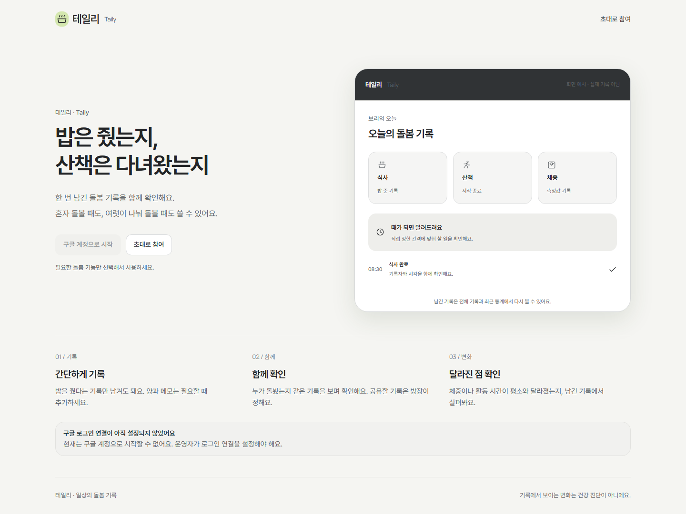
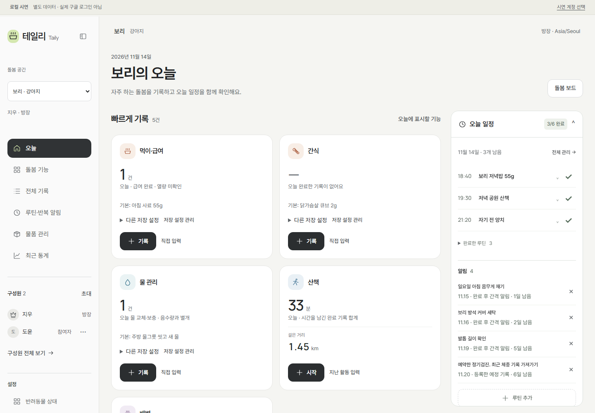
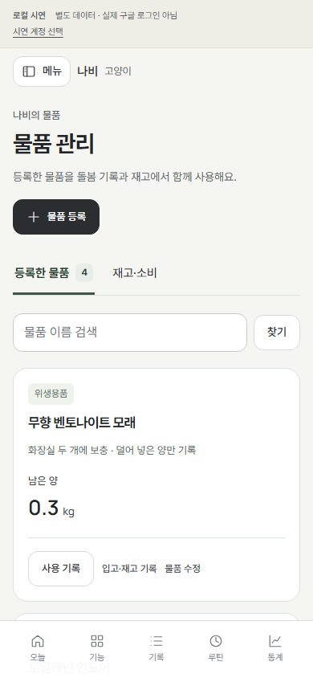
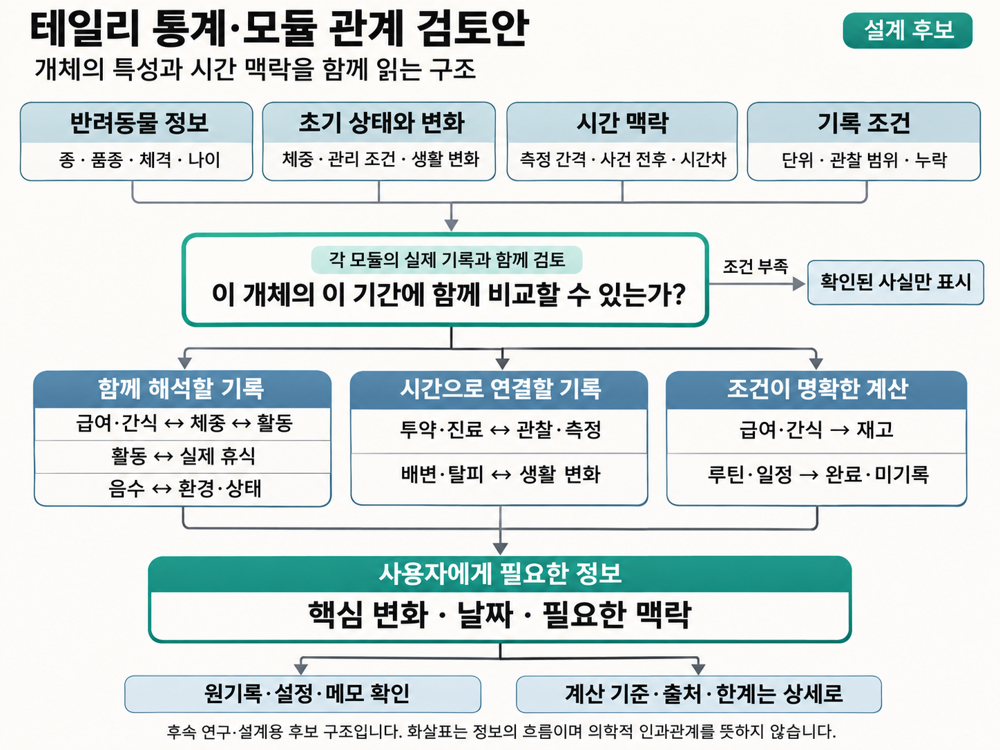

# [첫 배포 03] 테일리 — 내 컴퓨터에서 외부 주소로

> 2026-11-15 · 11월 12일 첫 배포와 그 전후의 7·8차 개선 기록

지난 글 끝에 다음 목표는 첫 배포라고 썼다. 외부 주소에서 기록을 넣고 다시 볼 수 있게 만드는 것이다.

11월 12일, 테일리를 Google Cloud 서버에 올려 HTTPS 주소로 열었고 내 구글 계정으로 로그인까지 해 봤다. 서버를 꾸리고 명령어를 치는 일은 AI가 했다. 나는 수업 자료에 맞춰 조건을 정했고, 구글 로그인 설정은 콘솔에서 직접 했다. 이 글의 앞부분은 배포하면서 막힌 이야기, 뒷부분은 그 전후로 사이트를 고친 이야기다.

## 수업 자료에 맞춰 구성을 바꿨다

지금까지 테일리는 Django와 SQLite로 내 컴퓨터에서만 돌렸다. 그런데 수업에서 추가로 받은 첫 프롬프트 템플릿에는 PostgreSQL, Docker Compose, 외부에서 들어올 수 있는 HTTPS 주소가 적혀 있었다. 그래서 배포는 이 자료대로 맞춰 달라고 했다.

AI는 지금까지 만든 화면과 기능은 그대로 두고, 그 바깥의 실행 구성만 새로 만들었다. 프로그램 세 개가 각자 컨테이너에서 돈다.

| 구성 | 맡은 일 |
| --- | --- |
| Caddy | 바깥에서 들어오는 접속을 받는다. HTTPS 인증서와 CSS 같은 정적 파일도 여기서 처리한다 |
| Django | 지금까지 만든 화면, 기록 입력·조회, 권한, 통계 |
| PostgreSQL | 사용자와 돌봄 기록 저장 |

Docker Compose는 이 셋을 한 번에 띄우는 설정 파일이다. 사용자는 HTTPS 주소 하나로 들어오고, 그 뒤에서 Caddy가 Django로, Django가 DB로 이어 준다. 화면을 React 같은 별도 앱으로 다시 만들지는 않았다.

서버 DB는 빈 상태로 새로 만들었다. 내 컴퓨터에 있던 시연 계정과 가상 기록은 옮기지 않았다. 확인용으로 만든 예시가 처음부터 실제 기록과 섞이면 나중에 가려내기 어렵다.

서버는 예전에 만들어 둔 Google Cloud 무료 체험 계정으로 만들었고, 유료 계정으로 전환하지는 않았다. 다만 남은 크레딧과 정확한 만료일은 그때 확인하지 못했다. 그래서 무료 체험이 끝나기 전, 발표가 끝난 뒤인 12월 13일 오전 9시에 서버가 저절로 꺼지도록 해 두었다.

## 설치돼 있다고 켜져 있는 건 아니었다

처음 막힌 곳은 코드가 아니라 실행 환경이었다.

Docker는 깔려 있었는데 엔진이 꺼져 있어서 컨테이너가 하나도 뜨지 않았다. Docker Desktop을 켜고 다시 돌리니 세 개가 모두 올라왔다.

Google Cloud 명령은 PowerShell 실행 정책에 막혔다. AI는 컴퓨터 전체의 정책을 풀지 않고, 같이 설치돼 있던 `gcloud.cmd`로 우회해서 실행했다. 서버로 파일을 옮긴 뒤에는 일반 사용자 권한으로 관리자 전용 폴더에 들어가려다 또 막혔다. 이것도 폴더 권한을 풀지 않고, 관리자 명령에 전체 경로를 넘기는 방법으로 넘어갔다.

이 부분은 내가 푼 게 아니다. AI가 원인을 설명하고 직접 고쳤다. 내가 얻은 건 프로그램이 없어서 안 되는 것, 꺼져 있어서 안 되는 것, 권한이 없어서 안 되는 것이 전부 다른 문제라는 감각 정도다. 화면에는 셋 다 그냥 '안 된다'로 보인다.

## 구글 로그인: 비슷하게 생긴 칸 두 개

주소가 처음 열렸을 때는 아래처럼 보였다. 구글 로그인을 연결하기 전이라 아래쪽에 아직 설정되지 않았다는 안내가 떠 있다.

*11월 12일, 외부 HTTPS 주소로 연 첫 화면.*

구글 로그인은 내가 콘솔에서 직접 설정했고, 실수도 여기서 나왔다. 로그인용 클라이언트를 만들면 'JavaScript 원본'과 '승인된 리디렉션 URI'라는 칸이 따로 있다. 나는 콜백 주소를 원본 칸에 넣었다가 오류를 봤다. 처음 안내할 때 AI도 두 칸의 차이를 분명히 짚어 주지 않았다.

| 칸 | 넣어야 하는 값 |
| --- | --- |
| JavaScript 원본 | 테일리 주소의 도메인까지 (`https://taily-34-61-117-164.sslip.io`) |
| 승인된 리디렉션 URI | 같은 주소 뒤에 `/auth/google/callback/`까지 |

원본은 로그인을 시작하는 사이트 주소이고, 리디렉션 URI는 구글에서 로그인을 마친 뒤 테일리로 돌아올 정확한 경로다. 생긴 건 거의 같은데 하는 일이 다르다.

인증 정보를 받는 과정도 안내와 달랐다. AI가 알려 준 JSON 파일 다운로드 위치가 실제 콘솔 화면과 맞지 않았다. 다시 찾아보니 지금 콘솔은 클라이언트를 만들 때 뜨는 창을 닫으면 보안비밀을 다시 보여 주지 않는다. 결국 클라이언트 ID와 보안비밀은 내가 로컬 파일에 직접 적어 넣고, AI는 그 값을 화면에 띄우지 않은 채 서버 설정으로 옮기는 식으로 마무리했다.

마지막 연결 확인에서는 `redirect_uri_mismatch` 오류가 한 번 더 났다. 승인된 리디렉션 URI를 저장하고 다시 시도하니 그제야 구글 로그인 화면이 떴고, 내 계정으로 로그인했다. 서버 DB에 구글 계정이 하나 생긴 것도 확인했다.

## 어디까지 확인했나

화면이 뜨는 것만 보고 끝내지는 않았다. 확인한 것은 이렇다.

- PostgreSQL로 바꾼 상태에서 기존 자동 검사 346개 통과
- 컨테이너를 지우고 다시 만들어도 기록과 작성자·돌봄 공간의 연결이 남는지 확인 (로컬 검증 환경)
- 외부 HTTPS 주소에서 첫 화면, DB 상태 확인 경로, CSS가 정상 응답. `http://`로 들어오면 `https://`로 넘어감
- PC 폭(1440px)과 휴대전화 폭(390px)의 Chromium에서 첫 화면 오류 없음
- 서버에 매일 DB 백업을 걸고, 첫 백업을 임시 DB에 실제로 복원해 봄

자동 검사와 브라우저 검사는 AI가 돌렸고, 실제 계정 로그인은 내가 했다. 그런데 그때 서버 DB에는 내 계정 하나뿐이고 돌봄 공간도 기록도 없었다. 외부 주소에서 반려동물을 등록하고, 기록을 넣고, 다시 보는 데까지는 아직 해 보지 못했다. 과제 최소 조건으로 보면 가장 먼저 채워야 할 빈칸이다.

첫 배포 주소는 [https://taily-34-61-117-164.sslip.io](https://taily-34-61-117-164.sslip.io)였다. 확인을 마친 뒤 서버는 꺼 두고, 개선 작업은 내 컴퓨터에서 이어 갔다. 그래서 지금은 이 주소로 들어가도 열리지 않는다. 주소 안에 서버 IP가 그대로 들어 있어서, 서버를 다시 켜면서 IP가 바뀌면 주소와 구글 로그인 설정도 같이 고쳐야 한다.

## 배포 전후로 고친 것

지난 글에는 1~6차를 정리했다. 그 뒤로 7차(11월 10일), 첫 배포와 입력 흐름 개선(12일), 8차와 후속 수정(13~14일)이 이어졌다. 지난 글처럼 차수마다 대표 사례를 먼저 쓰고 패치 노트를 붙였다. 7차는 첫 배포에 들어갔고, 그 뒤에 고친 것은 아직 서버에 올리지 않은 로컬 버전이다. 8차의 체크 기호 수정까지는 GitHub 저장소에 올렸다.

### 7차: 숫자를 늘리기 전에, 무엇을 센 숫자인지부터

6차까지 이전 값과 최근 값을 제대로 비교한 건 체중과 산책뿐이었다. 다른 기능까지 넓히려니 각 기록이 정확히 무엇을 뜻하는지부터 걸렸다.

물을 갈아 줬다는 기록은 물을 마셨다는 기록이 아니다. 사료 55g을 줬다고 55g을 다 먹은 것도 아니다. 잠잘 시간을 알림으로 정해 뒀다고 실제로 잔 시간이 생기지도 않는다. 이런 걸 섞어서 숫자를 내면 그래프는 그럴듯해도 틀린 이야기를 하게 된다. 그래서 이런 구분을 포함해 기능마다 무엇을 입력받고 무엇을 계산하는지 다시 따져 보게 했다.

AI는 준 양과 먹은 양, 물 교체와 실제로 잰 음수량, 계획한 일정과 실제 기록을 따로 계산하도록 바꿨다. 여러 기록을 같이 볼 때도 같은 기간의 원래 기록을 펼쳐 볼 수 있게 했다.

**패치 노트**

- 먹이·간식에 제품과 기본 급여량을 저장해 두는 '저장 설정' 추가
- 저장 설정으로 빠르게 기록. 기록할 때의 설정값은 따로 보존
- 통계 범위 확대: 급여·간식, 실제로 잰 음수량, 놀이·훈련·휴식, 사육환경 등
- 준 양과 먹은 양, 각각의 열량을 구분. 값이 없으면 임의로 채우지 않음
- 산책 시간과 거리는 한 카드에서 보되, 계산은 각자 기록된 값으로
- 위생·청소·배변은 남긴 기록 수, 일정은 완료·건너뜀·미기록으로 구분
- 재고와 연결한 급여는 준 양만큼 재고에서 차감
- 기록을 고치거나 취소하거나 같은 요청을 다시 보내도 재고가 두 번 빠지지 않게 처리
- 생활 변화를 특이사항 메모로 통합. 새로 고를 수 있는 기능은 18개, 이전 기록은 그대로

### 배포 직후: 기록할 때마다 페이지를 떠나지 않게

기능은 늘었는데 기록 하나 남길 때마다 다른 페이지로 넘어갔다 와야 해서 흐름이 자꾸 끊겼다. 오늘 화면과 돌봄 기능 화면에서 같은 기록 버튼의 위치가 서로 다른 것도, 구성원 관리 화면에 정보와 버튼이 한꺼번에 쏟아지는 것도 거슬렸다.

그래서 기록·루틴·저장 설정은 보던 화면 위에 입력창을 띄우는 방식으로 바꿨다. AI는 기존 입력 검사와 저장 함수는 그대로 두고 여는 방식만 바꿨다. 저장하고 나면 보던 분류와 스크롤 위치도 그대로 남는다.

검사하다가 까다로운 경우가 하나 나왔다. 서버에는 저장이 됐는데 응답만 중간에 끊기는 경우다. 이때 다시 누른 것을 새 기록으로 받으면 같은 산책이 두 번 남는다. 그래서 다시 보낼 때는 새로 저장하지 않고, 앞서 보낸 요청이 어떻게 됐는지부터 확인하게 했다. 느리게 열리던 이전 입력창의 응답이 새로 연 창을 덮어쓰는 문제도 이때 찾아서 고쳤다.

**패치 노트**

- 기록 추가·수정, 루틴 등록·수정, 저장 설정 편집을 화면 위 입력창으로
- 입력 오류가 나도 같은 창에서 내용과 안내 유지
- 저장 후 검색·분류·스크롤 위치와 펼친 내용 유지
- 연타하거나 응답이 끊긴 뒤 다시 보내도 한 번만 저장
- 오늘·돌봄 기능 카드의 주요 버튼을 아래쪽으로 통일
- 구성원 패널을 본인 설정, 역할 변경, 내보내기 구역으로 나눔
- 시연 목록에 보리·나비·초록이를 먼저 보여 주고, 이전 검수용 공간은 따로 모음

### 8차: 일정은 옆에, 물품은 한곳에

다음으로 눈에 들어온 건 화면 비율이었다. 넓은 모니터에서 보면 오른쪽이 휑하게 비어 있는데, 정작 일정은 아래로 한참 내려야 보였다. 그래서 오늘 화면과 돌봄 기능 화면 오른쪽에 일정을 붙여 달라고 했다.

*8차 이후 보리의 오늘 화면. 오른쪽에 오늘 일정 패널이 붙었다. 로컬 시연용 가상 기록이다.*

설정도 정리했다. 반려동물 이름·품종·생일을 고치는 곳에 사료 등록과 구성원 관리까지 섞여 있으니 무엇을 설정하는 화면인지 알 수가 없었다. 동물 정보는 '반려동물 상태', 개인 알림과 공동 설정은 '일반 설정', 사료와 소모품은 '물품 관리'로 나눴다.

체격 입력도 손봤다. 3차 때 품종을 고르면 체격을 제안하게 했는데, 그 앞에 '품종 자료로 제안받기'와 '직접 고르기' 중 하나를 고르는 단계가 따로 있었다. 써 보니 그 단계가 왜 있는지 알기 어려웠다. 나는 품종을 고르면 체격이 자동으로 채워지고 회색으로 잠기는 방식을 제안했다. AI는 선택 단계는 없애되 칸을 잠그지 않고, 제안된 체격을 바로 고칠 수 있게 만들었다. 믹스나 품종 미상처럼 제안할 수 없는 경우, 그리고 전에 직접 골라 둔 값을 같은 칸에서 처리하려면 그쪽이 낫다는 이유였다.

물품 관리에서는 이미 등록한 사료를 또 등록하게 만들 이유가 없었다. AI는 기존 사료·간식 정보를 넓혀서 영양제·약·위생용품·생활 소모품까지 한곳에서 관리하게 했다. 급여나 청소를 기록할 때 쓴 물품을 고르면 재고는 그 기록을 그대로 읽는다. 지난 글에서 정한 '같은 활동은 한 번만 저장한다'는 원칙이 물품까지 이어진 셈이다.

*휴대전화 폭으로 줄인 브라우저에서 본 나비의 물품 관리.*

이때 하나 더 걸린 게 있었다. 투약 기록은 일반 참여자에게 숨길 수 있는데, 약을 물품으로 등록하면 재고 목록에서 약 이름이 그대로 보일 수 있었다. 그래서 물품 목록뿐 아니라 재고·이력·통계에도 같은 권한을 걸었다.

**패치 노트**

- 오늘·돌봄 기능 오른쪽에 일정 패널. 모바일에서는 위쪽에서 접었다 펼침
- 반려동물 상태와 일반 설정을 별도 창으로 분리
- 체격 입력의 '선택 방법' 단계 제거. 제안된 체격도 직접 수정 가능
- 물품 관리 추가: 등록한 물품 / 재고·소비 탭
- 사료·간식 외에 영양제·약·구충제·위생용품·생활 소모품 분류
- 급여는 준 양, 위생·청소 물품은 적은 사용량만큼 재고 반영. 양을 안 적으면 차감하지 않음
- 숨겨 둔 약이 재고 이름으로 드러나지 않게 재고·이력·통계에도 같은 권한 적용
- 개인 일정 안내와 공동 시간대·민감 기록 공개 설정 구분
- 좁거나 낮은 화면에서도 입력창의 저장·취소 버튼이 보이게 조정

### 8차 후속: 옆에 붙였다고 보기 편해지진 않았다

일정 패널을 붙이고 나서도 몇 번 더 고쳤다. 본문이 양쪽 메뉴 사이에 끼어 좁아 보여서 30% 정도 넓혀 달라고 했다. 스크롤을 내리면 '오늘 일정' 제목이 위쪽 메뉴 뒤로 숨어 버리기도 했다.

패널 전체를 화면에 고정하고 나니 이번엔 큰 일정 카드가 줄줄이 이어져 답답해 보였다. 그래서 시간·이름·완료 체크를 한 줄에 넣고, 설명은 눌렀을 때만 펼치게 줄였다. 완료 버튼은 동그라미에서 체크박스 모양으로 바꿨다가, 결국 체크 기호만 남겼다. 누르면 항목이 아래 '완료한 루틴'으로 옮겨 가는데, 상자 안에 체크가 남는 모양은 그 동작과 어울리지 않았다.

**패치 노트**

- 큰 화면에서 본문 폭 확대 (2560px 화면에서 기능 영역 약 30%)
- 제목·완료 개수·목록을 포함한 일정 패널 전체를 화면에 고정. 긴 목록은 패널 안에서 스크롤
- 일정 한 줄에 시간·이름·완료 체크
- 완료한 루틴은 아래 묶음으로 모으고, 알림은 따로 표시
- 목록이 짧으면 패널도 그만큼 줄어듦

## 통계 관계도도 그려 봤다

화면을 고치는 동안 통계를 어디로 끌고 갈지도 다시 생각했다. 여러 기능의 숫자를 한 페이지에 늘어놓는 것을 '종합 상태'라고 부르고 싶지는 않았다. 체중이 변했다면 그 사이에 먹는 것, 활동, 생활 환경 중 무엇이 바뀌었는지 같이 볼 수 있어야 한다.

그걸 AI와 같이 정리한 그림이 아래 관계도다. 지난 글의 ERD가 데이터를 어디에 저장하고 어떻게 잇는지에 대한 그림이라면, 이건 어떤 기록끼리 같이 봐야 의미가 있는지에 대한 그림이다.

*[관계도 크게 보기](../assets/statistics-relations/taily-statistics-relations.png). 아직 설계 후보다. 화살표는 같이 볼 정보를 이은 것이지, 원인과 결과가 확인됐다는 뜻이 아니다.*

그림의 연결은 세 종류다.

- **같이 볼 기록:** 급여·간식과 체중·활동, 활동과 실제 휴식, 잰 음수량과 환경·상태
- **시간을 맞춰 볼 기록:** 실제 투약·진료 전후의 관찰, 배변·탈피를 기록한 때의 생활 조건
- **계산으로 바로 이어지는 기록:** 급여와 재고 차감, 예정된 루틴과 완료 기록

예를 들어 사료 55g을 주고 그 사료 재고와 연결했다면, 재고에서 55g을 빼는 건 그냥 계산이다. 이 부분과 루틴 완료 연결은 이미 돌아간다. 하지만 사료를 바꾼 뒤 체중이 늘었다고 사료 탓이라고 말할 수는 없다. 언제 사료를 바꿨고 언제 체중을 쟀는지, 그 순서부터 맞춰 봐야 한다.

7차에서는 같은 기간의 기록을 나란히 보는 데까지 만들었다. 그다음으로 두 번의 체중 측정 사이에 실제로 바뀐 사료나 생활 사건을 날짜와 함께 찾아 주는 방향을 검토했다. 다만 이 기능과, 기록할 당시의 나이·상태를 따로 남기는 구조는 아직 만들지 않았다. 그림에는 아직 계획인 부분이 섞여 있다.

## 시연 예시도 실제 생활처럼 다시 만들었다

시연 화면에는 '검수용 사료' 같은 이름, 거의 같은 숫자가 반복되는 기록, 스크롤을 확인하려고 넣은 일정이 그대로 남아 있었다. 그래서 사료 이름부터 기록과 루틴까지 실제로 키우는 사람이 쓸 법하게 바꿔 달라고 했다.

AI는 로컬 DB를 먼저 백업하고 보리·나비·초록이 세 공간의 데이터만 다시 짰다.

| 예시 | 새로 짠 생활 |
| --- | --- |
| 보리 | 6.3kg 안팎의 비숑. 아침·저녁 사료, 평일과 주말이 다른 산책, 양치·빗질, 주 1회 체중 측정 |
| 나비 | 4.2kg 안팎의 코리안 쇼트헤어. 나눠 먹는 건사료, 급수기와 화장실 두 곳, 낚싯대 놀이와 늦게 들어와 건너뛴 날 |
| 초록이 | 71~73g의 그린칙 코뉴어. 펠렛과 채소, 손 타기 연습, 케이지 밖 놀이, 바닥 종이 교체 |

최근 4주치로 기록 773개, 물품 13개, 루틴 21개, 반복 알림 6개를 만들었다. 전부 가상으로 꾸민 생활이고, 실제 보호자가 쌓은 기록은 아니다. 사료 이름은 제조사 공식 페이지에서 확인한 실제 제품을 썼고, 확인하지 못한 열량은 비워 뒀다.

급여 기록만 늘리다 보니 사료 재고가 먼저 바닥나는 일도 생겼다. DB 복사본으로 미리 돌려 보다가 사료를 다시 사기 전에 잔량이 모자라는 걸 발견해서 시작 재고를 고쳤다. 물을 갈아 준 기록을 음수량으로 바꾸거나, 자기 전 준비를 수면 시간으로 채우는 일은 하지 않았다. 그래프를 채우자고 모르는 값을 넣으면 7차에서 나눈 기록의 의미가 다시 흐려진다.

**패치 노트**

- 세 동물에 맞게 생일·종류·체중·사용 기능 조정
- 검수용 제품 이름을 실제 사료·간식·생활용품 이름으로 교체
- 일상 시간대에 맞춰 급여·산책·놀이·청소 기록과 담당자 연결
- 밥을 조금 남긴 날, 짧게 끝난 산책, 놀이를 건너뛴 날과 메모 추가
- 구매·사용 기록과 재고 잔량, 다시 사야 하는 기준 연결
- 스크롤 확인용 임시 일정을 지우고 저장 설정이 있는 루틴으로 교체

## 아직 남은 문제

루틴 완료 버튼이 아직 말썽이다. 일부 일정은 체크를 눌러도 '필수 항목입니다'만 뜨고 완료되지 않았다. 처음엔 이유를 몰라서 AI에게 물어보고 나서야 원인을 알았다. 체크를 누르면 루틴 완료와 함께 상세 돌봄 기록도 저장하려 하는데, 그 기록에 필요한 값이 비어 있으면 저장이 거부된다. 그런데 어떤 값이 빠졌는지 알려 주지 않고, 그 자리에서 채울 방법도 없었다.

시연 예시에서는 필요한 기본값을 맞춰서 21개 루틴이 모두 완료되고 다시 눌러도 중복 저장되지 않는 것을 확인했다. 하지만 이건 예시를 맞춘 것이지 문제를 푼 게 아니다. 사용자가 새로 만든 일정에서 값이 빠졌을 때 무엇을 어떻게 안내할지, 체크 한 번으로 끝나는 완료와 자세한 기록을 어떻게 이을지는 다음에 정해야 한다.

배포도 다음 할 일이 분명하다. 서버를 다시 켜고 최신 버전을 올린 뒤, 외부 주소에서 반려동물을 등록하고 기록을 넣고 다시 보는 데까지 직접 해 봐야 한다. 휴대전화 화면은 브라우저 폭을 줄여서만 봤고, 실제 휴대전화로 쓰거나 여러 사람이 오래 써 본 적은 아직 없다.

## 배운 것

처음엔 배포를 '만든 사이트를 서버에 올리는 일' 정도로 생각했다. 해 보니 DB가 어디에 남는지, 프로그램이 정말 켜져 있는지, 로그인하고 어디로 돌아오는지, 백업을 실제로 되살릴 수 있는지가 전부 엮여 있었다. 명령어는 AI가 쳐 줘도, 내가 콘솔에 직접 넣는 주소가 무슨 역할인지는 내가 알아야 했다. 리디렉션 URI를 한 칸 잘못 넣은 것만으로 로그인이 막혔다.

화면도 비슷했다. 일정을 옆에 붙이면 편해질 줄 알았는데, 붙이고 나니 제목이 가려지고, 카드가 무거워 보이고, 체크가 먹지 않는 문제가 줄줄이 나왔다. 결과 화면을 직접 보면서 어디가 좁은지, 무엇이 왜 안 눌리는지 구체적으로 짚어야 다음 수정도 구체적으로 나왔다.

이 글은 AI가 작업 기록으로 쓴 초안을 Claude와 함께 고친 것이다.
