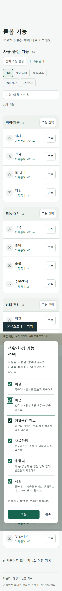
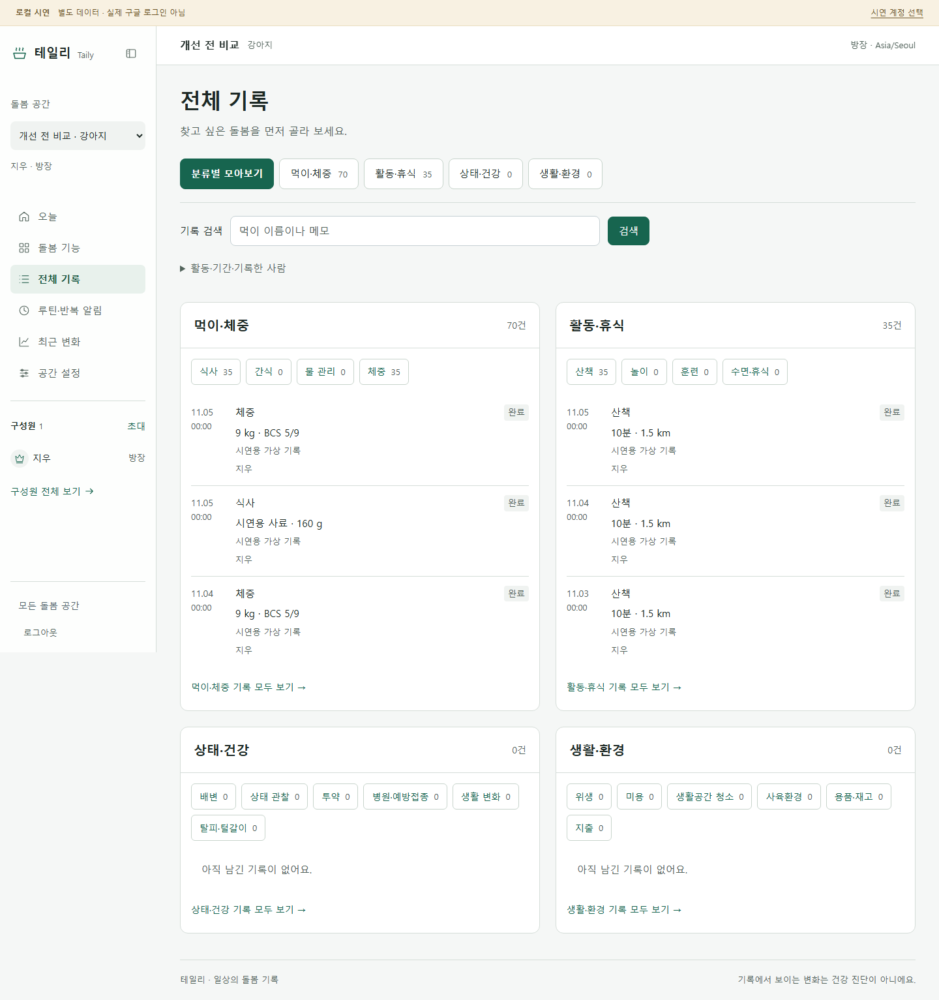
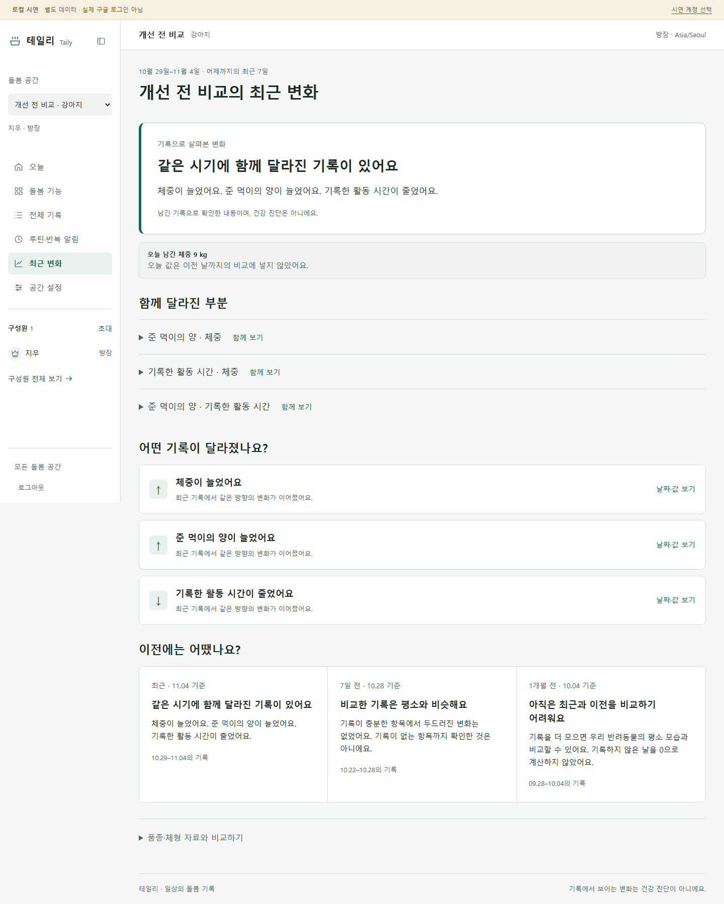

# 테일리 4차 개선 — 구현과 검수 결과

2026-11-05. 사용자가 지적한 한국어 표현, 실제 작업 흐름과 결과의 이해 문제를 중심으로 개선했다. 외부 사이트를 참고해 구성·사용 흐름·표현을 검토하고, 관련 연구와 설계 기준을 비교한 뒤 구현했다. 이 문서는 실제 반영 내용과 확인 범위를 설명한다. 외부 게시나 서비스 배포는 하지 않았다.

## 실행

프로젝트 폴더에서 아래 명령을 실행한다. 기존 서버가 사용 중인 포트를 강제로 종료하지 않는다.

```powershell
.\.venv\Scripts\python.exe -X utf8 scripts\run_phase4_preview.py
```

주소는 `http://127.0.0.1:8015`다. 검수는 기존 8000·8001·8013 대신 이 주소에서 한다. 시연 계정의 ‘방장으로 보기’를 선택하면 기존 시연 데이터의 복사본과 별도로 만든 ‘4차 검수 예시’를 볼 수 있다. 여섯 예시의 기록은 가상 값이며 실제 반려동물 기록이 아니다. 기존 저장소는 덮어쓰지 않았다. 구글 실계정 인증을 대신한 성공 판정도 아니다.

## 여섯 요구의 연결

|요구|실제 반영|확인할 곳|
|---|---|---|
|한국어 전반 재작성|메뉴·첫 화면·필드·안내·오류·확인·권한·동적 저장 안내의 문맥과 행동을 다시 작성했다. 사용자 데이터는 변경하지 않았다.|돌봄 기능, 기록창, 반복 알림, 초대, 설정|
|사용자 관점의 이론과 작업 검토|기록 수집→확인→행동의 장벽, 기록 중단·재개, 설명과 탐색, 반복 사용, 조작의 발견·예측·피드백을 실제 작업에 연결했다.|설계 근거 문서와 아래 전후 비교|
|분석과 결과 표현|끝난 날짜의 기록 비교, 기록 방식 변화 구분, 큰 단일 차이 확인, 실제 변화 날짜의 겹침을 반영했다. 쉬운 결과를 먼저 읽고 날짜·값을 펼친다.|최근 변화|
|분류 중심 기록|첫 화면부터 먹이·체중/활동·휴식/상태·건강/생활·환경으로 모았다. 활동·기간·기록자·검색·페이지 조건을 상세와 수정 이후에도 보존한다.|전체 기록|
|글자·색·대비|한글 시스템 글꼴, 본문 16px 기준과 상대 크기, 보조 정보 13px 이상, 어절 중심 줄바꿈과 대비를 정돈했다. 색 외의 선택 표시·문구를 유지한다.|전체 화면·확대 검사|
|분류 안 기능 선택|분류 제목 옆에서 해당 기능만 체크해 적용한다. 적용 후 같은 분류에 남고 다른 분류의 순서·오늘 표시·기록을 바꾸지 않는다.|돌봄 기능 → 기능 선택|

기능명과 별도의 ‘기록·통계 보기’가 같은 곳으로 연결되던 중복을 합쳤다. 기능 이름 아래에서 상세 기록·통계로 가고, 옆의 기록 버튼은 바로 입력창을 연다. 반복되는 ‘필요할 때 기록’ 안내는 덜어냈다. 전체 순서를 조정하는 별도 설정과 키보드·터치 정렬은 유지했다.

## 한국어를 바꾼 방식

‘모듈’을 ‘돌봄 기능’으로 바꾼 것만이 전부는 아니다. 무엇을 할 수 있는지와 누르면 어떤 일이 생기는지가 맞도록 문장을 다시 썼다. 예를 들어 처음 화면은 ‘밥은 줬는지, 산책은 다녀왔는지’로 사용 상황을 먼저 설명하고, 초대 링크 사용 중단과 이미 참여한 사람의 내보내기를 구분한다. 저장 실패에는 입력이 남아 있는지와 다음에 누를 동작을 알려준다.

같은 기능은 ‘돌봄 기능’, ‘전체 기록’, ‘최근 변화’, ‘반복 알림’로 일관되게 부른다. 기록한 사람과 실제 돌본 사람, 준 양과 먹은 양, 예정과 완료의 의미는 쉽게 쓴다는 이유로 합치지 않았다. 고유한 반려동물 이름·메모·기록 내용과 과거 수정 이력은 그대로다.

## 최근 변화의 계산과 결과

외부 언어모델·생성형 AI API 없이 Python 계산을 실행한다. 이전의 강건한 개인 기준선은 유지하되, 다음 오류 가능성을 직접 구분했다.

하루가 끝나기 전의 일부 기록을 완성된 날의 합계와 비교하지 않는다. 기본 비교는 어제까지 7일과 그 앞 28일이다. 오늘 남긴 체중·변화 관찰은 별도로 보여준다. 기간 전체가 부족한 값은 충분한 값과 나누되, 충분한 자료의 결과까지 모두 판단 불가로 바꾸지 않는다.

한 번 크게 달라진 값은 지속 변화가 아니어도 확인할 기록으로 표시한다. 기록을 남긴 횟수나 종류가 달라져 합계가 커진 경우는 생활 변화와 구별한다. 함께 달라졌다고 연결하려면 실제 달라진 날짜가 겹쳐야 한다. 식사량과 열량으로 같은 사실을 중복 가산하지 않고, 미기록을 실제 미급여·미활동·0으로 채우지 않는다. 상반된 신호도 한 점수로 상쇄하지 않는다.

화면에서는 결론→관련 변화→날짜·값→원래 기록으로 이어진다. 펼친 화면에도 계산식·중앙값·알고리즘 설명을 놓지 않았고, 이해를 위해 그래프를 읽을 필요가 없게 했다. 이론과 계산 선택은 [설계 근거](15_테일리_4차설계근거.md)와 [분석 방법 문서](12_종합상태_분석방법.md)에 남겼다. 품종 자료 비교는 별도 보조 정보로 유지한다.

분석 문턱과 자료량 조건은 서비스 설계값이며 임상 정상 범위나 검증된 위험 확률이 아니다. 기록 방식의 변화를 자동으로 모두 알 수 있는 것도 아니다. 수동 기록의 변화가 실제 동물의 변화와 같다고 보장하지 않는다.

## 동일 기록으로 작업을 다시 재생한 결과

동일한 돌봄 기록 **105건**의 주요 열 값을 비교해 보존됨을 확인하고, 1440×1000 브라우저에서 대표 작업을 전후 재생했다. 사람을 모집한 실험이 아니라 개발자 관점의 작업 점검이다.

|작업|개선 전|개선 후|
|---|---|---|
|분류에서 청소 기능 추가|전체 기능 설정으로 나갔다가 사용 화면으로 복귀: 페이지 이동 2회|분류 안 선택창에서 적용: 페이지 이동 0회|
|식사 기록 찾기|시간순 목록에서 필터를 열어 원하는 종류를 지정|첫 화면의 분류별 묶음에서 식사로 진입|
|상세 확인·수정 후 복귀|목록의 조건을 다시 찾아야 할 수 있음|검색·분류·활동·기록자·기간·페이지가 담긴 안전한 복귀 주소 유지|
|어떤 변화인지 이해|계산 용어와 추세 그림, 설명이 함께 노출|짧은 결과를 읽고 한 번 펼쳐 날짜·값 확인|

분류를 처음 고르는 경우와 이미 고른 경우의 출발점이 다르므로 클릭 수 감소율을 계산하지 않았다. 자동 클릭 속도를 사람의 작업 시간으로 보고하지도 않는다. 개선 전 선택 목록도 분류로 필터링할 수 있었으므로 ‘기존에는 항상 20개를 모두 읽어야 했다’고 주장하지 않는다. 이번 차이는 현재 분류 안에서 선택·저장·확인까지 끝내는 것이다.

화면 전체 높이도 함께 기록했다. 높이가 줄었다는 사실만으로 사용성이 입증되는 것은 아니다.

|화면|개선 전|개선 후|
|---|---:|---:|
|돌봄 기능|1306 px|1280 px|
|전체 기록|3074 px|1533 px|
|최근 변화|2203 px|1798 px|
|루틴|1000 px|1000 px|
|전체 기능 설정|2110 px|2267 px|

글자를 키우고 빈 분류에서도 추가할 곳을 보여주면서 일부 화면의 길이는 늘 수 있다. 모든 화면이 짧아졌다고 처리하지 않았다. 전체 순서를 다루는 설정은 남겨 두되, 일상적인 기능 추가 때문에 그 긴 화면을 왕복하지 않도록 바꿨다. 분류별 기록 첫 화면은 일부 최근 기록만 요약하며 전체 이력은 각 분류에서 계속 볼 수 있다.

## 확인한 동작

자동 회귀 테스트 **216개**, 브라우저 검사 **22개 지점**, 12개 주요 화면×6개 폭의 **72개 배치 검사**를 통과했다. 별도로 글자 200%와 사용자 간격 변경, 320px, 터치 조작과 영문 품종 검색을 점검했다. 확대·간격 변경 **9개 경우**에서 문서 가로 넘침이 없었고, 대표 텍스트 역할 **17곳**의 실제 계산 대비는 최소 **6.37:1**이었다. 전체 WCAG 인증이나 모든 브라우저·실물 기기 검증을 뜻하지 않는다.

선택창의 취소·Escape·초점 복원·Tab 순환, 저장 실패·재시도·응답 유실·동시 변경 충돌을 검사했다. 첫 브라우저 검사에서는 Tab 초점이 창 밖으로 나가는 문제가 나와 고친 뒤 다시 확인했다. 글자 간격 검사 도구의 인라인 스타일이 보안 정책에 막힌 경우에는 앱의 보안 정책을 낮추지 않고 같은 출처의 검사용 스타일시트로 검사 방식을 바꿨다.

권한은 표시만 숨기지 않고 서버에서 검사한다. 게스트는 기능 설정을 변경할 수 없고 제한된 기록이 목록·결과·근거 링크에 드러나지 않는다. 그룹 변경과 기능 숨김으로 기존 분석 이력이 삭제되지 않는다. 원래 기록용·시연용 DB는 직접 수정하지 않았으며 검증·시연 예시는 별도 DB에 있다.

```powershell
.\.venv\Scripts\python.exe -X utf8 scripts\verify_phase4.py --browser
```

검사 로그와 실패·수정 자료는 로컬 작업 폴더에 남겼다. 브라우저 검사는 임시 DB와 8016번 포트를 사용하고 종료 시 자신이 띄운 검사 서버만 닫는다.

## 검수 화면





화면의 데이터는 개발자가 만든 가상 예시다. 실제 사용자 테스트 결과가 아니다.

## 남은 확인

실제 구글 OAuth 자격증명으로의 로그인, 실제 휴대전화·보조기술의 전체 호환성, 보호자가 반복해서 사용하는 장기 사용성·분석 효용은 아직 확인하지 못했다. 실제 참여자가 없는데 인터뷰·성공률·만족도를 만들어 쓰지 않았다. 테스트의 성공은 코드의 명시한 동작을 확인한 결과다.

Unslop의 사용 사실과 제작자·원본·라이선스, 실제 분석·수치 기준의 필수 출처는 [사용 도구 및 출처](../THIRD_PARTY_NOTICES.md)에 유지한다.
