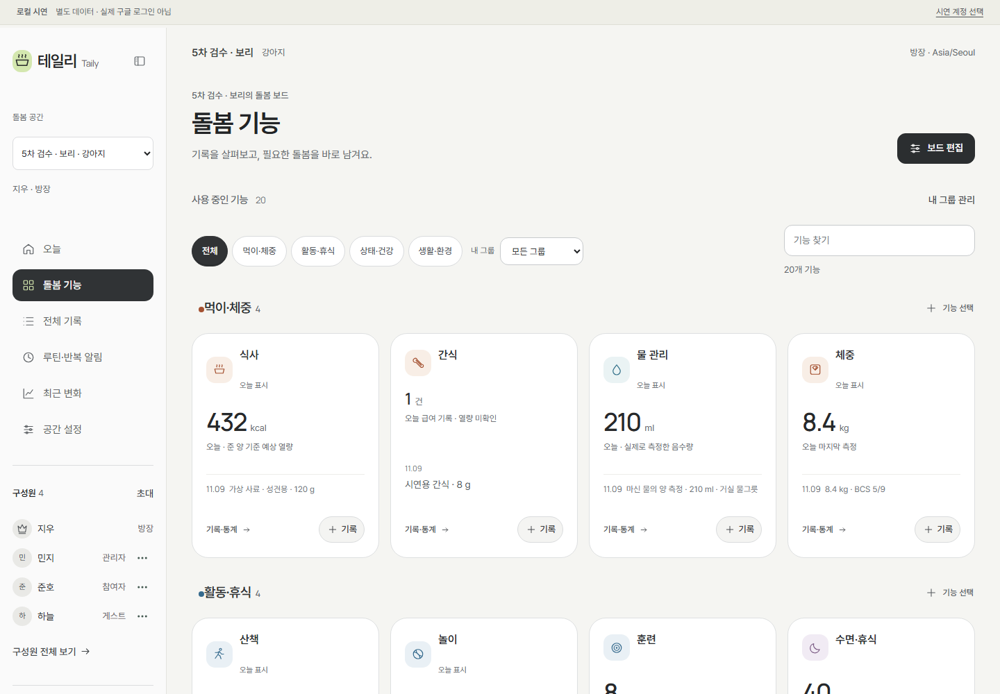
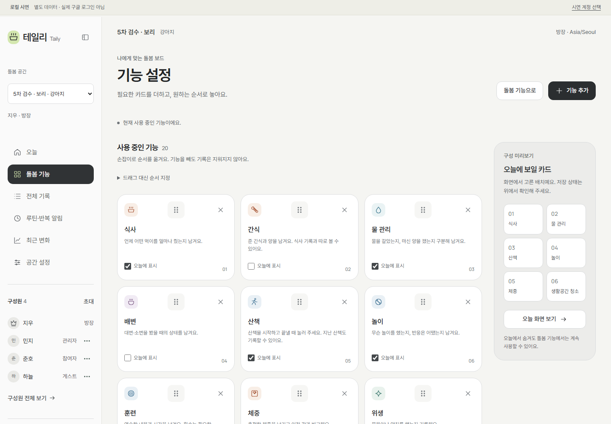
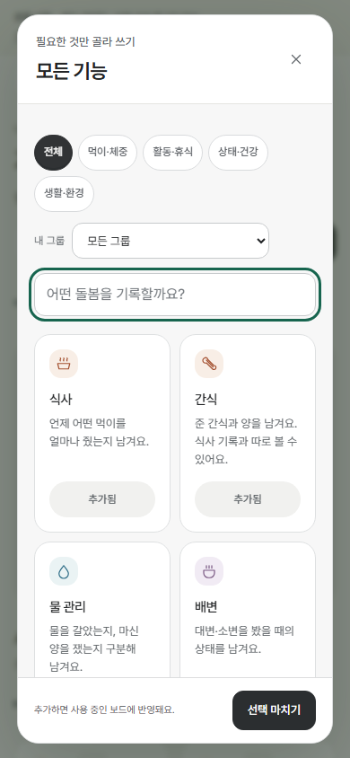
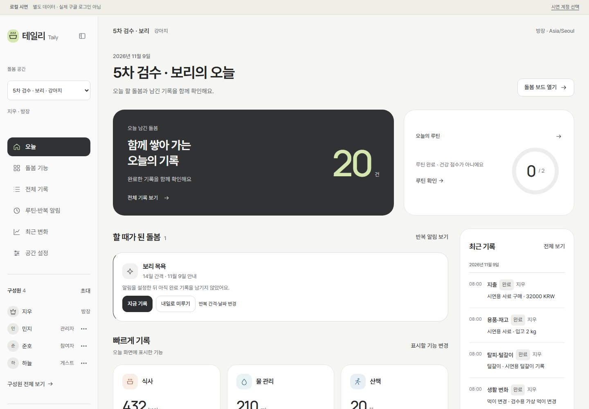
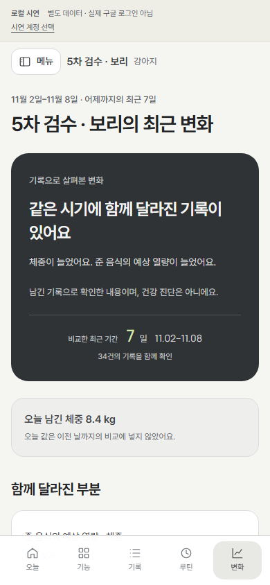

# 테일리 UI 재설계 — 5차 두 번째 개선

2026-11-09. 이전 개선은 오늘·최근 변화에 비해 돌봄 기능과 전체 기능 설정의 형태가 덜 바뀌었다. 사용자는 색의 수보다 사용하는 방식, 화면 내부의 구성, 서체의 역할을 다시 설계해 달라고 했다. 기존 PC 탐색의 위치는 유지하되 두 핵심 화면의 템플릿과 편집 동작을 실제로 교체했다. 이번 결과도 로컬 검수본이며 업로드나 배포는 하지 않았다.

## 실행과 확인 순서

프로젝트 폴더에서 다음 명령으로 실행한다.

```powershell
.\.venv\Scripts\python.exe -X utf8 scripts\run_studio_preview.py
```

주소: `http://127.0.0.1:8021`. 기존 8015·8017과 구분한다. **방장으로 보기 → 5차 검수 · 보리 → 돌봄 기능 → 보드 편집 → 기능 추가** 순서로 보면 이번에 바뀐 두 화면을 바로 확인할 수 있다. 시연 데이터는 이전 검수본의 별도 복사본이며 실제 보호자의 기록이 아니다. 기능이 적은 예시와 빈 기록 예시도 같은 시연 계정에서 볼 수 있다.

## 무엇이 달라졌나

|영역|앞선 구현|이번 구현|
|---|---|---|
|돌봄 기능|분류별 긴 행 목록에 최근 기록 한 줄|기능별 독립 카드. 실제 수치·단위와 의미, 최근 기록, 입력 동작을 한 카드에 배치. 측정값 카드와 사건 기록 카드의 강조 방식도 구분|
|기능 설정|사용 목록과 전체 목록을 함께 길게 표시|사용 카드의 배치 보드와 오늘 표시 미리보기. 전체 기능은 필요할 때 여는 별도 선택 창으로 분리|
|순서 변경|세로 목록의 이동 좌표|가로·세로 카드 위치를 기준으로 드래그. 키보드 좌우·상하·처음·끝과 기능/순번 선택 방식도 유지|
|색|분류별 파스텔 헤더·버튼의 반복|바탕·탐색·일반 글자는 중립색, 핵심 요약은 짙은 면과 작은 강조. 유형의 차이는 작은 아이콘과 필요한 정보에 집중|
|서체|시스템 서체 중심|Pretendard는 본문·제목·조작부, Manrope는 큰 숫자와 기간·건수에 제한해 사용|
|오늘·최근 변화|수치 카드와 결과 블록|요약과 실제 완료 상태, 결론과 비교 기간의 위계를 분리. 루틴 원형 표시는 실제 완료 비율이며 건강 점수가 아님|
|기록·상세·통계·공동 사용|기존 공통 시각 체계|기록함의 제목·건수·내용, 통계의 수치·기간, 루틴·구성원·등록·입력창을 같은 서체·면·간격 체계로 연결|

분류별 선택창, 검색/내 그룹, 빠른 기록, 저장 취소, 날짜·작성자 필터와 목록 복귀는 유지했다. 기능을 빼거나 오늘에서 숨겨도 이전 기록은 삭제되지 않는다. 편집 중 미리보기는 현재 선택한 배치이며 서버 저장 성공을 대신 표시하는 것이 아니다. 저장 실패·버전 충돌은 기존 저장 상태 영역과 재시도/불러오기에 표시한다.

## 색과 글자를 결정한 이유

외부 다종 기록 서비스의 구성과 사용 흐름을 참고하고, 기본 탐색과 개별 기록의 강조를 분리했다. 모든 요소에 색을 칠하지 않고, 자주 읽는 바탕과 글자는 차분하게 두었다. 개별 기능의 색은 레이블·아이콘·내용과 함께 사용하므로 색만 구분해야 하는 구조가 아니다. 모든 기록 카드에 임의의 그래프를 붙이거나 측정하지 않은 건강 점수를 만들지 않았다.

두 서체는 공식 배포본을 수정하지 않고 같은 서버에서 제공한다. 일반 화면에서 외부 폰트 서버로 요청하지 않는다. `font-display: swap`과 시스템 글꼴 폴백을 두었고, 폰트 요청을 실패시켜도 글자와 조작이 남는지 확인했다. 서체 파일의 저작권·배포 출처·OFL 원문은 [서체 출처](../static/care/fonts/README.md)에 보관했다. Unslop의 간격·타이포그래피·색 사용·상태 피드백 검토와 필수 출처는 [사용 도구 및 출처](../THIRD_PARTY_NOTICES.md)에 유지한다.

## 같은 기록으로 전후 확인

같은 가상 기록을 기준으로 화면 구성과 조작을 비교했다. 기능 설정에서 사용 카드와 사용하지 않는 기능의 두 목록을 동시에 읽어야 하는 구조를 없앴다. 새로운 기능은 기능 목록에서 선택한 뒤 같은 배치 보드에 바로 반영되고, 오늘 표시 여부도 그 자리에서 바꿀 수 있다. 카드 순서는 가로·세로 이동 후 새로고침해 저장됨을 확인했다.

|화면|화면 폭|이전 문서 높이|이번 문서 높이|
|---|---|---:|---:|
|돌봄 기능|1440px|1834px|2804px|
|돌봄 기능|390px|3217px|4525px|
|기능 설정|1440px|2637px|2160px|
|기능 설정|390px|5197px|3184px|

문서 높이는 사용성 점수가 아니다. 기능 카드에 실제 수치와 최근 내용을 더 담으면서 일부 화면의 스크롤 길이는 늘었다. 많은 기능을 모두 켠 경우에는 분류·검색·내 그룹으로 좁히는 동선을 유지했다. 모든 화면이 짧아졌거나 사람이 더 빨리 작업한다는 실험 결과로 쓰지 않는다.

## 확인한 범위

- 자동 회귀 **245개**. 측정값·미기록·물 보충·과거 체중·취소/미래 기록과 권한 경계를 포함한다.
- Chromium 브라우저 검사 **31개 지점**과 주요 15개 화면×6개 폭의 **90개 배치**. 기능 라이브러리·가로/세로 정렬·키보드·터치·저장 실패·두 탭 충돌·빠른 기록·취소·루틴 연결·초대·구성원 권한을 포함한다.
- 글자 확대·간격 변경·320px 재배치 **15개 경우**, 대표 텍스트 대비 **182곳**을 확인했다. 검사 표본의 최소 대비는 **4.64:1**이며 전체 접근성 인증을 뜻하지 않는다.
- 최종 Waitress 검수 서버에서 주요 화면 20개 경우와 **20개 기능 입력창×PC/모바일의 40개 경우**, 기능 목록창 2개 폭, 실제 로컬 폰트 응답·로드·폴백을 확인했다.
- Firefox 157.0에서도 16개 화면/폭 조합과 라이브러리 초점·키보드 이동 취소·입력창 열고 닫기를 확인했다.

실제 발견한 오류는 새 기능 목록창의 Tab 초점이 창 바깥으로 빠질 수 있던 것이다. 창 안 순환과 Escape 후 시작 버튼 복귀를 명시적으로 연결한 뒤 다시 확인했다. 이전 세로 정렬의 y좌표만 재사용하지 않고, 카드의 원래 배치 칸을 고정 기준으로 삼아 이동 중 재배치가 목표를 흔들지 않게 했다.

## 보존과 한계

기존 실제/시연 DB 2개와 앞선 검수 DB 2개의 업무·권한 관련 테이블을 전후 비교했다. 로그인 시각과 요청 제한 카운터는 별도 관리하며 원래 돌봄 기록·설정·권한 값은 바뀌지 않았다. 기존 서버와 작성 중이던 초안·미추적 파일을 보존했다. 데이터 모델, 저장/권한 처리, 통합 분석 엔진의 파일도 바꾸지 않았다. 새 수치 표시는 기존 집계 규칙을 재사용하는 읽기 전용 연결이다.

실제 보호자의 반복 사용 선호·사용 시간은 측정하지 않았다. 실제 휴대전화와 보조기술 전체, 구글 실계정 인증은 별도 검수가 남아 있다. 참조 서비스의 계정이 필요한 내부 흐름을 모두 직접 조작한 것으로 기록하지 않는다. 공개 예시 관찰과 실제 조작·정적 근거의 범위는 구분했다.

## 검수 화면

아래는 이번 구현의 실제 로컬 화면이며 가상 시연 데이터다.







## 재검사

```powershell
.\.venv\Scripts\python.exe -X utf8 scripts\verify_studio.py --browser
.\.venv\Scripts\python.exe -X utf8 scripts\verify_studio_firefox.py
```

첫 명령은 별도 검증 DB와 8022·8023·8024를 사용한다. 두 번째 명령은 실행 중인 8021 검수 서버에 읽기 중심으로 접근하며 시연 로그인 외의 쓰기 요청이 없음을 검사한다. 포트가 사용 중일 때 다른 프로세스를 강제로 종료하지 않는다. 테스트 서버와 로컬 브라우저는 검사 종료 시 자신이 시작한 것만 닫는다.
