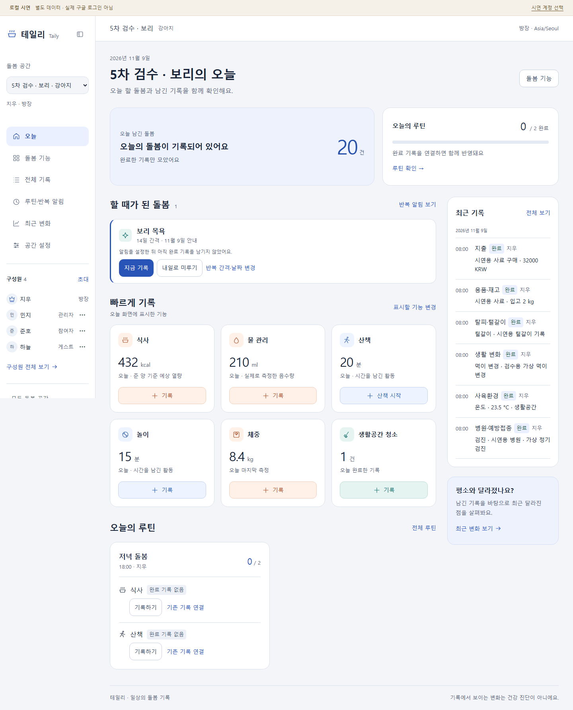
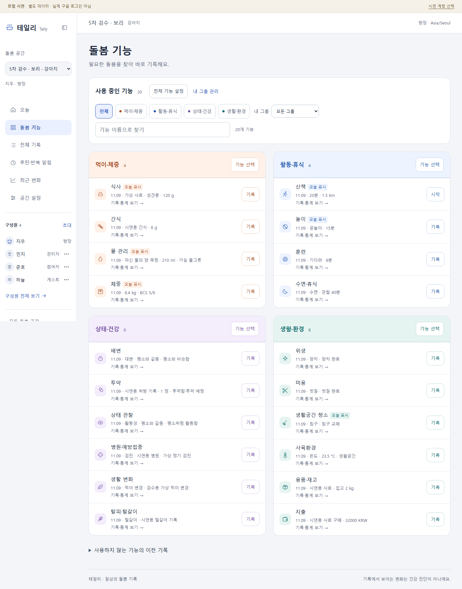
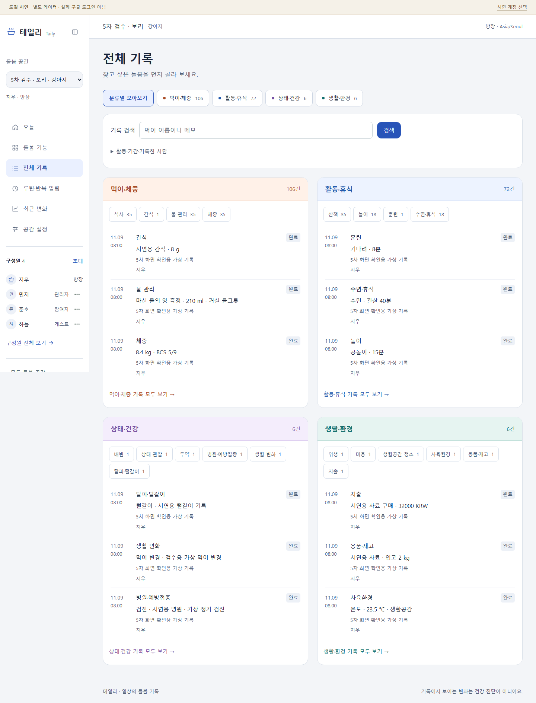
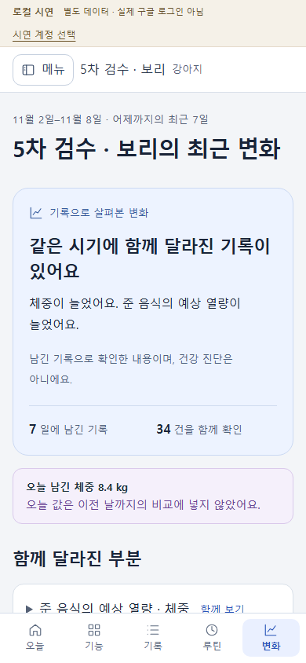

# 테일리 5차 — 색상·수치·탐색을 함께 정리한 UI·UX 개선

2026-11-09. 기존 PC 화면의 위치·배열 중 좋은 부분은 유지하고, 초록색 중심의 반복적인 인상을 바꿨다. 외부 서비스의 구성·사용 흐름과 공개 디자인 자료를 참고하고, 정보 시각화 연구와 접근성 기준을 적용했다. 이 문서는 로컬 구현·개발자 검수 결과이며 공개 배포나 사용자 연구 완료를 뜻하지 않는다.

## 실행과 검수

프로젝트 폴더에서 실행한다.

```powershell
.\.venv\Scripts\python.exe -X utf8 scripts\run_local.py --demo --profile dashboard --port 8017
```

주소는 `http://127.0.0.1:8017`이다. ‘방장으로 보기’ → **5차 검수 · 보리**를 선택한다. ‘모듈 5개’와 ‘처음 시작’ 예시도 준비했다. **모든 추가 예시는 개발자가 만든 가상 기록**이며 실제 건강·급여 자료가 아니다. 원래 기록용 DB와 8015 서버를 그대로 두고 별도 복사본을 사용한다. 다른 PC에서 실행하면 기본 시연 데이터가 준비되며 이번 PC의 별도 예시 DB까지 자동 복제되지는 않는다.

## 무엇이 달라졌나

|화면|유지한 구조|변경한 표현과 동작|
|---|---|---|
|오늘|빠른 기록, 루틴·주기, 오른쪽 최근 이력|실제 완료 기록 건수와 루틴 완료 비율을 구분. 각 돌봄 카드에 해당 데이터의 수치·단위·의미 표시|
|돌봄 기능|4분류·검색·내 그룹, 분류 안 기능 선택|분류별 색상·아이콘, 가장 최근 완료 기록의 날짜와 짧은 내용, 가까운 입력 버튼|
|전체 기록|분류 우선, 기간·활동·작성자·검색과 상세 복귀|분류 제목/선택 상태/기록 내용/시간의 위계를 구분하고 기존 PC 2열 모음 유지|
|최근 변화|기존 기록 기반 판단과 원본 근거|결론 먼저, 확인한 기록 범위, 최근 수치 범위. 반복되는 설명은 펼친 상태에서 제공|
|개별 통계|기존 집계·그래프·단위 처리|최근 7·30·90일 바로 선택, 해당 분류 색상과 수치 위계|
|루틴·설정·구성원·등록|기존 기능·권한·입력 조건|공통 카드·버튼·입력·팝업·오류 상태와 글자/간격 정돈|
|모바일 탐색|원래 메뉴와 방 전환 유지|오늘·기능·기록·루틴·변화 하단 탐색. 메뉴를 열면 하단 탐색의 초점·표시를 잠시 제외|
|기능 순서|마우스·터치·키보드 드래그와 저장|접힌 ‘드래그 대신 순서 지정’에서 기능과 위치를 선택해 클릭만으로 이동 가능|

### 다색 사용 원칙

공통 동작은 파랑, 먹이·체중은 따뜻한 주황, 활동·휴식은 청색, 상태·건강은 보라, 생활·환경은 청록으로 구분했다. 바탕은 중립색이며 분류 이름과 아이콘을 함께 표시한다. 색을 건강 점수나 좋음·나쁨의 자동 판정으로 쓰지 않는다. 중요한 버튼과 숫자는 눈에 띄게 하되 모든 카드에 그래프·장식을 반복하지 않는다.

세 가지 색상안을 비교한 뒤 공통 동작과 분류가 잘 구별되는 안을 선택했다. 이 선택은 개발자의 설계 판단이며 실제 사용자의 선호도 조사 결과가 아니다. PC는 왼쪽 탐색과 다열을 유지하고, 모바일에는 좁은 폭·터치에 맞는 배열과 하단 탐색을 따로 적용했다.

## 수치의 의미를 바꾸지 않기

오늘 카드의 숫자는 새 계산 모델이 아니라 기존 통계 함수의 결과를 읽는다. 준 양 기준 예상 열량과 실제 먹은 양으로 계산한 열량을 구분하고, 섞여 있거나 일부 열량이 없으면 그 사실을 표시한다. 실제 섭취량 0은 확인된 값으로 유지한다. 모르는 값은 0으로 채우지 않는다.

물 교체·보충은 마신 양이 아니므로 건수로 보여준다. 활동 시간을 모르면 활동 기록 건수와 시간 미입력을 표시한다. 과거 체중만 있으면 실제 측정 날짜를 붙인다. 아직 기록이 없으면 대시(—)와 안내를 보여준다. 취소·예정·미래 기록은 오늘 완료 수치에 섞지 않는다.

‘최근 변화’의 최근 범위는 실제 비교 자료의 최솟값~최댓값이며 정상·목표 범위가 아니다. 분석 엔진, 데이터 모델, 인증·권한 정의, 제품 영양 스냅샷과 루틴 연결 규칙은 변경하지 않았다. 상태 계산에서 외부 언어모델 API를 호출하지 않는다.

## 연구를 실제 작업에 연결한 부분

정보 시각화의 개요→필터→상세·관계·이력이라는 관점을 화면 역할과 복귀 흐름에 적용했다. 수치 해석에는 의미 없는 게이지나 면적 비교를 늘리기보다 단위와 값, 비교 범위를 명확히 표시했다. 사람의 시각 인지 연구를 반려동물 건강 분석의 임상 근거로 쓰지 않았다.

드래그의 접근성은 키보드 지원만으로 끝내지 않았다. 단일 포인터 조작으로도 기능과 순번을 골라 같은 저장 경로를 사용할 수 있게 했다. 위·아래 화살표를 모든 행에 다시 추가하지 않고 필요한 사용자만 펼치게 했다.

- Shneiderman (1996), *The Eyes Have It*: https://hci.stanford.edu/courses/cs448b/papers/shneiderman96eyes.pdf
- Heer & Bostock (2010), *Crowdsourcing Graphical Perception*: https://hci.stanford.edu/publications/2010/crowd-perception/heer-chi2010.pdf
- W3C WCAG 2.2 대비: https://www.w3.org/WAI/WCAG22/Understanding/contrast-minimum.html
- 재배치·텍스트 간격: https://www.w3.org/WAI/WCAG22/Understanding/reflow.html , https://www.w3.org/WAI/WCAG22/Understanding/text-spacing.html
- 드래그 대체: https://www.w3.org/WAI/WCAG22/Understanding/dragging-movements.html

## 실제 확인 결과

|검사|결과|
|---|---|
|자동 회귀|236개 통과. 이번 수치·권한·탐색 경계 20개 포함|
|주 브라우저|18개 검사 지점 통과|
|공동 사용·연결 흐름|8개 통과: 그룹 저장 실패/충돌, 루틴 연결·취소, 미루기, 역할 변경, 게스트 초대·기록·내보내기, 마우스 정렬·사이드바|
|반응형|15개 화면×6개 폭, 90개 배치에서 문서 가로 넘침 없음|
|확대·간격·좁은 화면|12개 경우 통과|
|실제 계산 텍스트 대비|136곳, 최저 5.07:1. 지정한 텍스트 역할의 측정이며 전체 접근성 인증은 아님|
|최종 로컬 실행본|PC·모바일 16개 화면과 20개 기능×2개 폭의 40개 입력창 확인|
|비교 자료 보존|개선 전후 같은 활동 253건의 전체 열 값 일치|

새 테스트에서는 제공량/섭취량·혼합 열량·누락/0, 물 관리 의미, 취소/예정/미래 제외, 이전 체중 날짜, 다른 방과 민감 기록 차단, 렌더링으로 데이터·분석이 바뀌지 않음, 최신 기록 조회·HTML 이스케이프를 검사했다. 그룹 충돌에서는 내 입력을 유지하고 다른 사람의 저장을 무단 덮어쓰지 않았다. 게스트를 내보낸 뒤 접근은 차단하되 작성 기록은 남았다.

첫 모바일 드래그 검사에서 손잡이가 고정 하단 탐색 아래에 있는 상태로 눌린 것을 확인했다. 실제 타깃을 화면 중앙에 두고 검사하도록 수정하고, 제품에서는 포커스 스크롤 여유와 드래그 중 탐색 숨김을 보완했다. 확대 검사 도구의 콜백 오류는 도구 쪽을 수정했으며 제품 보안 정책을 낮추지 않았다. 시연 모드와 테스트 러너 설정 충돌, 게스트 가입의 필수 동의 누락 역시 검사 설정/절차 문제와 제품 오류를 구분해 남겼다.

```powershell
.\.venv\Scripts\python.exe -X utf8 scripts\check.py --browser
```

검사는 8018·8019·8020 포트와 분리 DB를 사용하며 사용 중인 서버를 강제로 종료하지 않는다. 로그와 오류 자료는 로컬 작업 폴더에 저장한다. 실제 기록용·시연용 원본 두 DB와 이전 검수 DB의 기존 테이블 값을 비교해 보존됨을 확인했다. 사용자가 작성 중인 블로그와 미추적 파일도 그대로다.

## 화면






모든 화면은 검수용 가상 데이터다. 자동 클릭 속도를 사람의 작업 시간으로 보고하지 않았으며, 단계 수·화면 길이만으로 사용성이 입증됐다고 주장하지 않는다. 이번 목표는 모든 페이지를 짧게 만드는 것이 아니라 기존 위치·기능을 유지하면서 정보와 동작을 구별하는 것이다.

## 남은 확인

실제 구글 OAuth 자격증명으로의 로그인, 실물 휴대전화·보조기술 전체 호환성, 실제 보호자의 반복 사용에서의 만족도와 장기 분석 효용은 별도 확인이 필요하다. 기능 검사와 사용자·임상 연구를 구분한다. 외부 서비스의 관찰이 제한된 부분은 직접 사용한 것으로 기록하지 않았다.

이번 작업은 로컬 구현·로컬 커밋까지만 진행했다. GitHub push·PR·외부 배포·LMS 제출은 하지 않았다. Unslop 사용 사실, 제작자·원본·라이선스는 [사용 도구 및 출처](../THIRD_PARTY_NOTICES.md)에 유지했다.
