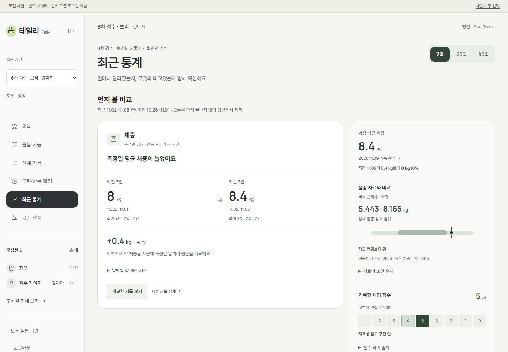
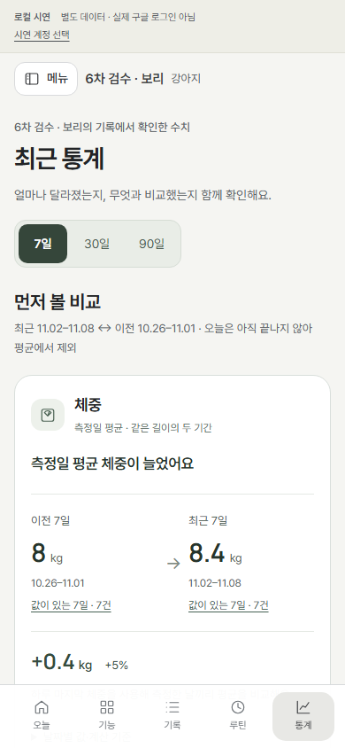
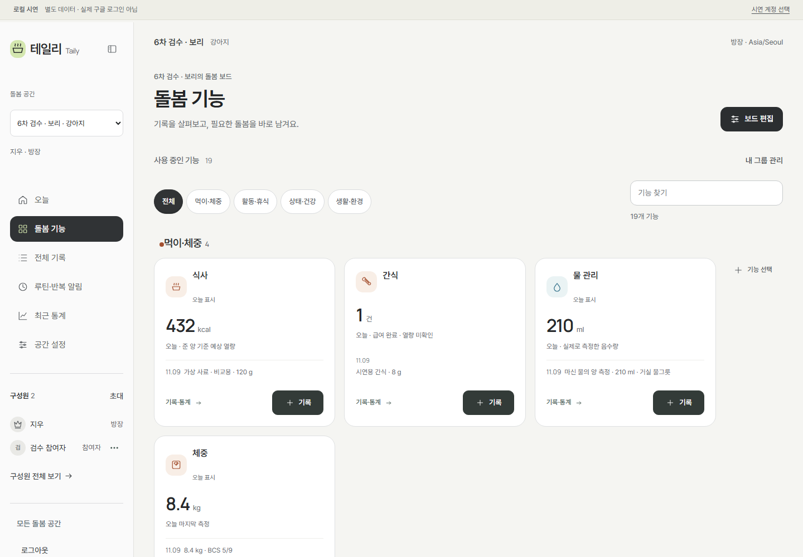
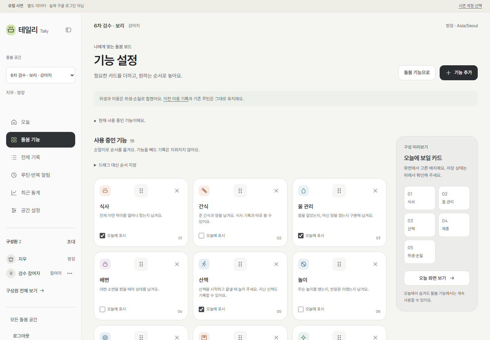

# 테일리 6차 — 모듈과 최근 통계

2026-11-09 · 로컬 검수본. 기존 20개를 입력부터 결과 표시까지 검토했고, 신규 선택은 **19개**로 정리했다. 숫자를 채우는 새 기능을 넣지 않고 미용을 위생·손질로 통합했다. 이전 미용 기록과 수정 이력, 이미 연결된 루틴·반복 알림은 보존했다.

## 실행과 확인

프로젝트 폴더에서 다음 명령으로 실행한다.

    .\.venv\Scripts\python.exe -X utf8 scripts\run_module_statistics_preview.py

주소는 **http://127.0.0.1:8025**. 기존 8015·8017·8021과 구분한다. 이 PC의 검수 계정에서 **방장으로 보기 → 6차 검수 · 보리 → 최근 통계**를 연다. 돌봄 기능의 산책 거리, 가로형 기록 버튼, 카드 옆 기능 선택과 보드 편집도 함께 확인한다. 화면의 예시는 격리 DB에 만든 가상 기록이며 실제 보호자 정보가 아니다. 새 환경에서는 기본 시연 데이터를 사용하며 이 PC의 추가 검수 예시를 원격으로 배포하지 않는다.

## 결과를 말하다 끝내지 않기

최근 통계는 변화 방향만 알려주지 않는다. **이전 값 → 최근 값 → 차이와 비율 → 비교 기간·기록일 수 → 근거 기록**을 같은 카드에서 보여준다. 최초 핵심 지표는 체중과 산책 시간·거리다. 사용하지 않는 핵심 모듈은 자동으로 끼워 넣지 않는다. 다른 돌봄은 목적에 맞는 완료·양·시간·잔량·비용의 요약으로 연결하고 모든 항목을 외부 평균과 비교하지 않는다.

가상 예시의 체중은 이전 측정일 평균 8kg에서 최근 8.4kg으로 **+0.4kg, +5%**다. 같은 화면에서 가장 최근 실제 측정과 직전 측정의 차이도 별도로 보여준다. 두 비교의 기간과 의미를 구별한다. 작은 변화는 양끝을 같게 반올림한 채 증가라고 표시하지 않도록 표시 정밀도를 맞췄다. 이전 값이 0이면 무한 변화율을 만들지 않는다.

### 계산의 정의

- **같은 길이의 닫힌 기간:** 최근 7·30·90일을 그 바로 이전의 같은 길이 기간과 비교한다. 오늘은 끝나지 않아 기간 평균에서 제외하고, 오늘의 완료 기록과 최신 측정은 별도로 보여준다.
- **체중:** 단위를 kg으로 통일하고 하루의 마지막 유효 측정 한 개를 사용한다. 각 기간에서 실제 측정한 날의 평균이다. 미기록 날은 0kg이 아니다. 같은 날 측정을 여러 번 했다고 그 날의 가중치를 늘리지 않는다.
- **산책:** 시간과 거리를 독립적으로 계산한다. 한 날의 해당 수치를 모두 남긴 경우 그 날의 합계를 사용하고, 기록일의 합계를 평균한다. 예를 들어 시간이 있지만 거리가 없는 산책은 시간 비교에는 포함될 수 있으나 그 날의 거리 평균에서는 제외된다. 누락 날짜·건수를 드러낸다.
- **차이:** 최근 평균−이전 평균. 변화율은 이전 값이 0이 아닐 때 차이÷이전 값×100이다. 적은 관측일로 나온 평균과 큰 기록일 차이는 따로 안내한다. 통계적 유의성이나 건강 호전·악화를 뜻하지 않는다.
- **이전 변화 탐색:** 이전 28일/최근 7일의 강건한 대표값·반복 관측 방식은 별도의 접힌 영역에 남겼다. 새 평균 카드와 다른 계산임을 밝히고, 그 결과에도 이전·최근 값과 차이를 붙였다. 계산의 자세한 배경은 [분석 방법](12_종합상태_분석방법.md)에 보존했다.

### 외부 자료의 적용 범위

등록된 개·고양이의 품종·성별·성장 완료 조건에 맞는 기존 카탈로그 자료가 있을 때 **품종 참고 체중 범위**를 별도 표시한다. 모집단 평균이나 그 개체의 적정 목표 체중으로 이름을 바꾸지 않았다. 크기 분류만으로 정상 체중을 계산하지 않고, 믹스·품종 미상·성장기·자료 부족은 개인 기록 비교와 자료 부족 안내로 남긴다. 지원하지 않는 동물에 개·고양이의 참고 범위나 BCS를 적용하지 않는다.

BCS는 직접 기록한 평가값을 체중 옆에 표시하며, 몸무게에서 역산하지 않는다. 평가일·보호자/수의사 구분·자료상 참고 구간·출처가 분리돼 있다. 신체 치수만으로 적정 체중을 만드는 검증된 모델을 확보하지 못했으므로 체고 입력을 추가해 임의의 목표값을 만들지 않았다.

산책은 **우리 아이의 이전 기록**을 비교 기준으로 쓴다. 센서로 관측한 하루 전체 활동량을 사람이 입력한 산책 시간·거리와 같은 지표로 취급하지 않았다. 일치하는 모집단과 측정방법의 자료 없이 품종별 평균 km나 권장 거리를 만들어 제공하지 않는다.

## 모듈 재선정 결과

|기존 키|기존 이름|결정|비교·해석 방침|
|---|---|---|---|
|meal|식사|개선|개체별 동일 기준 추이만; 임의 권장열량 없음|
|treat|간식|개선|외부 평균 비교 제외|
|water|물 관리|유지·표시 개선|핵심 외부 평균 비교 제외|
|toilet|배변|유지·표시 개선|기록 이력, 질병 추정 안 함|
|walk|산책|개선|개체 자기 비교; 센서 활동 연구를 산책 거리 권고로 전용 금지|
|play|놀이|유지·표시 개선|개인 기록만; 핵심 외부 평균 제외|
|training|훈련|개선|품종 능력 순위/외부 평균 없음|
|weight|체중|개선|조건 일치 성견/성묘 품종 범위와 WSAVA BCS만 별도 제시|
|hygiene|위생|통합·개선|평균 비교 없음; 보호자가 정한 주기|
|grooming|미용|신규 선택 제외·위생으로 통합|과거 이력만; 선택 모듈 수에서 제외|
|cleaning|생활공간 청소|유지|평균 비교 없음|
|medication|투약|개선|복약 권장량/효과 진단/집단 평균 없음|
|observation|상태 관찰|유지·표시 개선|외부 비교 제외|
|veterinary|병원·예방접종|유지|평균 방문횟수로 건강 판단 금지|
|sleep|수면·휴식|개선|센서 24시간 수면 평균 비교 제외|
|environment|사육환경|유지·표시 개선|종별 근거·사육조건 없이는 자동 권장구간 안 줌|
|reproduction|생활 변화|개선|원인·상관 자동 단정 없음|
|shedding|탈피·털갈이|개선|종별 외부 평균 강제 없음|
|inventory|용품·재고|개선|사용자 재고 기준; 건강 지표 아님|
|expense|지출|유지·표시 개선|외부 지출 평균으로 돌봄 질 평가 금지|

기존 키 20개는 과거 자료를 읽는 스키마에 남고 **새로 선택하는 라이브러리는 19종**이다. 과거 키가 남아 있다는 이유로 새 활성화 수를 20으로 표시하지 않는다. 미용의 새 입력은 위생·손질의 빗질·털 손질·발톱 선택으로 옮겼다. 이전 미용의 상세·수정·취소·기존 루틴·알림은 계속 동작하며 원래 기록을 새 유형으로 몰래 바꾸지 않는다. 과거 그룹의 의미와 자료도 보존한다.

## 입력에서 표시까지의 공통 경로

입력 폼의 공통값은 활동 시각, 상태, 돌본 사람, 메모와 재전송 식별값/수정 버전이다. 인증된 구성원과 방 범위를 먼저 확인하고 **RecordForm → services.save_activity 또는 빠른 기록 → Activity의 타입별 payload·영양 스냅샷 → 수정 이력·감사 로그**로 저장한다. 단위·필수값·버전 충돌·CSRF·권한은 서버에서 확인한다.

화면은 저장값을 바꾸지 않고 **stats.get_statistics → dashboard.today_tiles/module_board_tiles → comparisons.recent_statistics** 등 목적에 맞는 읽기 전용 집계를 사용한다. 오늘, 돌봄 카드, 입력창, 상세, 전체 기록, 개별 통계와 최근 통계의 의미·날짜·단위를 연결했다. 취소는 원본을 지우는 대신 통계에서 제외하고, 민감한 투약·병원·지출은 허용된 역할의 범위 안에서만 집계·노출한다.

### 이번에 실제로 바로잡은 경계

식사·간식에서 제공량으로 예상한 열량과 확인한 섭취량의 열량·영양소·그래프를 섞지 않는다. 산책 종료 시각으로 계산된 시간이 입력 최대 범위를 우회하지 못하게 했다. 관찰 수면은 자정과 겹침을 반영하는 기존 집계를 오늘 카드에도 연결했다. 재고는 이전 이력을 이어 계산하고 개수 단위의 소수 입력을 막는다. 훈련 성공률은 시도 수와 기술별 결과를 함께 보여준다. 투약 예정 기록을 이미 투약한 것처럼 표현하지 않는다. 생활 변화의 새 입력에는 이전 산란용 수량을 노출하지 않되 기존 산란 기록의 편집은 유지한다.

BCS 정수 선택 검증은 원래 존재했던 기능이다. 이번에 새로 고친 오류라고 세지 않고 회귀 검사를 추가했다. 기록 없는 값과 실제 0, 다른 단위, 과거 값과 현재 값은 끝까지 구별한다.

## 버튼과 위치

기록 동작은 충분한 폭의 가로형 버튼으로 바꿨다. 줄바꿈이 다시 생긴 원인은 기존 button.button 규칙의 선택자 우선순위였고, 실제 브라우저에서 버튼의 계산된 스타일과 폭을 검사해 고쳤다. 분류의 기능 선택은 카드 묶음의 첫 행 바로 옆에 두며, 좁은 화면은 카드 근처에서 별도 줄로 이동한다. 빈 분류·검색 결과·터치·키보드 동작도 검사했다. 산책 카드에는 분과 km가 함께 나오고 거리 미입력을 0km로 만들지 않는다.

## 확인한 범위와 보존

자동 테스트 **285개**, Chromium 작업 검사 **33개 지점**, **90개 화면/폭 조합**, 확대·간격·좁은 화면 **15개 경우**를 통과했다. 텍스트 대비는 **221개 표본**, 최소 **4.64:1**을 확인했다. 전체 접근성 인증을 뜻하지 않는다. Firefox는 **16개 화면/폭 조합**과 주요 입력·키보드 동작을 검사했다.

최종 로컬 검수 서버에서는 **20개 주요 화면**, 선택 가능한 **19개 기능 입력창을 PC/모바일 각각 연 38개 경우**, 폰트 로드와 폴백을 확인했다. 실제 보호자 인터뷰·장기간 사용 효과나 모든 실물 휴대전화, 구글 실계정 인증을 검증한 것은 아니다.

원본·앞선 검수 DB **5개**의 업무·권한 테이블과 기존 사용자 파일을 비교해 보존을 확인했다. 데이터 모델과 인증 설정 파일은 변경하지 않았고 파괴적 DB 마이그레이션은 없다. 계산 엔진의 변경은 이번 범위에 맞게 테스트했다. 로컬 커밋까지만 수행하고 원격 업로드·외부 배포는 하지 않았다.

## 화면

## 모듈별 입력·처리·출력 상세

아래 입력 필드는 최종 코드의 정의를 반영한다. 선택 항목을 비워 둔 경우를 실제 0과 구별하며, 공통 시각·메모·버전·권한은 앞 절을 따른다. 과거 전용 유형은 새 라이브러리에서만 제외되고 조회/편집의 자료 구조는 보존한다.

### 식사 · meal

무엇을 얼마나 주었고 실제 섭취를 확인했는지 공유. **판단: 개선**

입력: **먹이 이름** (food_name, text, 선택); **준 양** (quantity, number, 필수); **단위** (unit, choice, 필수) — g / kg / oz / 개 / ml; **실제로 먹은 양** (consumed, number, 선택).

처리·검토: 제공량 예상 열량과 확인 섭취량의 혼합 합계/그래프를 분리; 미확인은 0 아님.

표시: 기준별 kcal/양과 미입력 건수, 원본 제품 스냅샷. 비교 방침: 개체별 동일 기준 추이만; 임의 권장열량 없음.

### 간식 · treat

식사 외 급여와 훈련 보상을 구별. **판단: 개선**

입력: **먹이 이름** (food_name, text, 선택); **준 양** (quantity, number, 필수); **단위** (unit, choice, 필수) — g / kg / oz / 개 / ml; **실제로 먹은 양** (consumed, number, 선택); **급여 이유** (reason, text, 선택).

처리·검토: 식사와 목적은 다르므로 유지; 제품/섭취 기준 분리 적용.

표시: 간식 이름·양·이유와 실제 완료, 식사와 중복 합산 금지. 비교 방침: 외부 평균 비교 제외.

### 물 관리 · water

교체·보충과 실제 마신 양 측정을 구별. **판단: 유지·표시 개선**

입력: **기록 종류** (kind, choice, 필수) — 물 교체 / 물 보충 / 마신 물의 양 측정; **물그릇·급수기** (container, text, 선택); **측정하거나 보충한 양** (amount, number, 선택); **단위** (unit, choice, 필수) — ml / L.

처리·검토: 교체/보충은 섭취량이 아니며 측정 기록만 ml로 환산.

표시: 마신 양/관리 횟수를 구분, 미측정 표시. 비교 방침: 핵심 외부 평균 비교 제외.

### 배변 · toilet

배변 종류와 보호자의 관찰 변화 공유. **판단: 유지·표시 개선**

입력: **종류** (kind, choice, 필수) — 대변 / 소변; **관찰 상태** (condition, choice, 필수) — 평소와 같음 / 평소와 다름 / 확인하지 못함; **관찰한 내용** (detail, text, 선택).

처리·검토: 횟수와 평소와 다른 관찰은 구분; 미기록=0회 아님.

표시: 대변·소변·변화 관찰 횟수 및 메모. 비교 방침: 기록 이력, 질병 추정 안 함.

### 산책 · walk

시작·종료, 산책 시간과 거리 관리. **판단: 개선**

입력: **산책 시간 (분)** (minutes, number, 선택); **이동 거리** (distance, number, 선택); **거리 단위** (distance_unit, choice, 필수) — km / m.

처리·검토: 거리 빠른 입력·외부 카드 표시; 거리/시간의 유효일을 독립 처리; 종료시간 유효범위 재검증.

표시: 분+km, 동일 길이 이전/현재 기간의 기록일 평균·변화량. 비교 방침: 개체 자기 비교; 센서 활동 연구를 산책 거리 권고로 전용 금지.

### 놀이 · play

실내 놀이 유형·시간·반응을 산책과 구별. **판단: 유지·표시 개선**

입력: **놀이 종류** (kind, text, 필수); **놀이 시간 (분)** (minutes, number, 필수); **반응** (reaction, choice, 필수) — 잘 참여함 / 보통 / 관심 적음 / 모름.

처리·검토: 시간 미입력과 완료 기록은 구분; 활동유형별 혼합 여부 명시.

표시: 놀이 종류·관찰 반응·기록시간. 비교 방침: 개인 기록만; 핵심 외부 평균 제외.

### 훈련 · training

기술별 훈련 시도·성공·시간 기록. **판단: 개선**

입력: **훈련 항목** (skill, text, 필수); **훈련 시간 (분)** (minutes, number, 필수); **시도 횟수** (attempts, number, 선택); **성공 횟수** (successes, number, 선택).

처리·검토: 기술이 다른 성공률을 단일 실력으로 해석하지 않도록 기술별 분모·성공 합계 제공.

표시: 기술·성공/시도와 가중 성공률, 미측정 표시. 비교 방침: 품종 능력 순위/외부 평균 없음.

### 체중 · weight

체중과 직접 평가한 BCS 변화를 축적. **판단: 개선**

입력: **체중** (weight, number, 필수); **단위** (unit, choice, 필수) — kg / g / lb; **체형 점수(BCS, 1–9점)** (bcs, choice, 선택) — 1 / 9 / 2 / 9 / 3 / 9 / 4 / 9 / 5 / 9 / 6 / 9 / 7 / 9 / 8 / 9 / 9 / 9; **체형을 평가한 사람** (bcs_by, choice, 선택) — 보호자 관찰 / 수의사 평가.

처리·검토: 체중 실제 이전/최근·차이/비율·날짜; 기존 BCS 정수 선택 검증 유지·회귀 확인; 참고 범위와 평균·적정체중 분리.

표시: 핵심 비교 최상단, 최근 두 측정과 동기간 평균, 품종 범위 및 BCS. 비교 방침: 조건 일치 성견/성묘 품종 범위와 WSAVA BCS만 별도 제시.

### 위생 · hygiene

목욕·양치·귀/발 관리 및 털/발톱 손질. **판단: 통합·개선**

입력: **관리 항목** (task, choice, 필수) — 목욕 / 양치 / 귀 세정 / 발 세정 / 빗질 / 털 손질 / 발톱 관리 / 기타; **다음 관리 예정일** (next_date, date, 선택); **관리 내용** (detail, text, 선택).

처리·검토: 미용의 빗질·털정리·발톱을 선택 활동으로 흡수; 기존 task값 유지.

표시: 위생·손질 단일 모듈, 종류별 완료·다음 일정. 비교 방침: 평균 비교 없음; 보호자가 정한 주기.

### 미용 · grooming

빗질·털정리·발톱의 기존 기록. **판단: 신규 선택 제외·위생으로 통합**

입력: **손질 항목** (task, choice, 필수) — 빗질 / 털 손질 / 발톱 관리 / 기타; **다음 손질 예정일** (next_date, date, 선택); **손질 내용** (detail, text, 선택).

처리·검토: 새 라이브러리는 위생·손질로 일원화; 구기록/링크/기존 루틴·반복알림·권한 유지; 과거 payload 변경 없음.

표시: 이전 미용 이력 안내와 위생·손질 이동; 기존 예약 경로 호환. 비교 방침: 과거 이력만; 선택 모듈 수에서 제외.

### 생활공간 청소 · cleaning

동물의 몸 관리와 별개인 생활 공간 청소. **판단: 유지**

입력: **청소 대상** (target, choice, 필수) — 화장실 / 케이지 / 수조 / 침구 / 기타; **청소 내용** (task, text, 필수); **다음 청소 예정일** (next_date, date, 선택).

처리·검토: 대상·작업별 이력; 케이지/화장실/수조를 동일 건강 수치로 합치지 않음.

표시: 종류·완료일·주기 안내. 비교 방침: 평균 비교 없음.

### 투약 · medication

처방대로 투약한 사실/못한 사실·예정 공유. **판단: 개선**

입력: **약 이름** (medicine, text, 필수); **처방·지시받은 용량** (dose, number, 필수); **단위** (unit, choice, 필수) — mg / ml / 정 / 방울 / 회분; **투약 여부** (result, choice, 필수) — 투약함 / 투약하지 못함; **처방·지시 내용** (instruction, text, 선택).

처리·검토: 투약 상태와 예정 라벨 혼동 제거; 약·단위별 분리; 투약 실패도 숨기지 않음.

표시: 투약함/못함·약명, 관리자만 민감 상세. 비교 방침: 복약 권장량/효과 진단/집단 평균 없음.

### 상태 관찰 · observation

식욕·활동·피부·행동의 주관 관찰. **판단: 유지·표시 개선**

입력: **관찰 항목** (category, choice, 필수) — 식욕 / 활동성 / 행동 / 피부·털 / 기타; **평소와 비교** (condition, choice, 필수) — 평소와 같음 / 변화 있음 / 판단하기 어려움; **관찰 내용** (detail, text, 필수).

처리·검토: 직접 관찰과 추정된 건강결과 분리; 평소와 다름 우선 노출.

표시: 관찰 분류·상태·날짜·내용. 비교 방침: 외부 비교 제외.

### 병원·예방접종 · veterinary

진료·검사·예방접종 및 다음 방문 이력. **판단: 유지**

입력: **방문 종류** (kind, choice, 필수) — 진료 / 예방접종 / 검진; **병원·기관** (clinic, text, 선택); **진료·접종 내용** (detail, text, 필수); **다음 방문 예정일** (next_date, date, 선택).

처리·검토: 예약과 완료 분리; 권한과 다음 날짜 유지.

표시: 종류·병원·마지막 완료/다음 일정. 비교 방침: 평균 방문횟수로 건강 판단 금지.

### 수면·휴식 · sleep

보호자가 실제 관찰한 수면·휴식 구간. **판단: 개선**

입력: **종류** (kind, choice, 필수) — 수면 / 휴식; **관찰한 시간 (분)** (minutes, number, 필수); **관찰한 특징** (quality, text, 선택).

처리·검토: 겹침 합집합과 자정 분할을 오늘 카드까지 공유; 하루 전체 수면으로 확대하지 않음.

표시: 관찰한 시간, 관찰 범위와 누락 표시. 비교 방침: 센서 24시간 수면 평균 비교 제외.

### 사육환경 · environment

파충류·조류 등 환경의 온습도/조명/pH 기록. **판단: 유지·표시 개선**

입력: **측정 항목** (metric, choice, 필수) — 온도 / 습도 / 조명 시간 / 수질 pH; **측정값** (value, number, 필수); **단위** (unit, choice, 필수) — °C / °F / % / 시간 / pH; **측정 위치** (location, text, 선택).

처리·검토: 지표/장소/단위별 측정만 비교, F→C, 통합 정상값 없음.

표시: 지표·장소별 최근/최소/최대와 조건. 비교 방침: 종별 근거·사육조건 없이는 자동 권장구간 안 줌.

### 생활 변화 · reproduction

식단·환경·돌봄 방식 변화의 맥락 이력. **판단: 개선**

입력: **변화 종류** (kind, choice, 필수) — 성장·생활 단계 / 먹이 변경 / 생활환경 변경 / 관리 방식 변경 / 기타 변화 / 이전 형식: 발정 관찰 / 이전 형식: 산란; **달라진 점** (detail, text, 선택); **다시 살펴볼 날짜** (next_date, date, 선택); **이전 기록의 알 개수** (eggs, number, 선택).

처리·검토: 현재 생활 변화와 과거 번식 형식 구별; 신규 입력의 무의미한 알 개수 필드 숨김.

표시: 날짜/유형/내용 타임라인; 과거 heat/egg 정확히 보존. 비교 방침: 원인·상관 자동 단정 없음.

### 탈피·털갈이 · shedding

털갈이·탈피·깃털갈이의 시작/끝 관리. **판단: 개선**

입력: **종류** (kind, choice, 필수) — 탈피 / 털갈이 / 깃털갈이; **관찰 내용** (detail, text, 선택).

처리·검토: 조류 깃털갈이 선택값 보완; 진행 중과 종료된 주기 구별.

표시: 진행 상태·시작/종료일·완료된 기간. 비교 방침: 종별 외부 평균 강제 없음.

### 용품·재고 · inventory

공동 돌봄의 소모품 잔량과 구매 기준. **판단: 개선**

입력: **품목** (item, text, 필수); **변동 종류** (movement, choice, 필수) — 입고 / 사용 / 직접 센 수량으로 맞추기; **수량** (quantity, number, 필수); **단위** (unit, choice, 필수) — 개 / g / kg / ml / L; **구매 알림 기준 수량** (minimum, number, 선택).

처리·검토: 개수 단위 정수 검증; 이전부터 이어진 재고 ledger를 요약에 반영.

표시: 품목별 잔량/구매 필요·사용자 기준. 비교 방침: 사용자 재고 기준; 건강 지표 아님.

### 지출 · expense

반려동물별 비용 부담과 내역 관리. **판단: 유지·표시 개선**

입력: **지출 내용** (item, text, 필수); **금액** (amount, number, 필수); **통화** (currency, choice, 필수) — 원 (KRW) / 달러 (USD) / 유로 (EUR) / 엔 (JPY) / 위안 (CNY); **분류** (category, choice, 필수) — 먹이·간식 / 병원·건강 / 용품 / 돌봄 서비스 / 기타.

처리·검토: 다른 통화/분류 합산 금지; 누락·권한 보존.

표시: 통화별 합계·항목·작성자·기간. 비교 방침: 외부 지출 평균으로 돌봄 질 평가 금지.

## 기능 근거와 출처

외부 다종 기록 서비스의 공개된 기능 설명과 접근 가능한 화면에서 비교 기간·분모·결측값·원본 연결·보관과 삭제의 차이를 참고했다. 공개 안내를 읽은 것과 계정이 필요한 내부 기능을 직접 조작한 것은 구분했다. 실제 확인한 범위를 넘어 기능 전체를 실행했다고 기록하지 않는다.

- AAHA, 2021 Nutrition and Weight Management Guidelines, Screening Evaluation: https://www.aaha.org/resources/2021-aaha-nutrition-and-weight-management-guidelines/screening-evaluation/ — 체중·체형·생활 맥락을 구별하는 참고 근거. 새 평균 차이의 의학적 판정 기준이 아님.
- AKC Breed Weight Chart: https://www.akc.org/expert-advice/nutrition/breed-weight-chart/ — 품종 자료의 체중 범위. 기존 카탈로그의 출처·확인 날짜와 적용 조건을 유지한다. 모든 품종의 자료를 이번에 새로 수집했다는 뜻은 아님.
- WSAVA Global Nutrition Guidelines: https://wsava.org/global-guidelines/global-nutrition-guidelines/ — BCS 원문 연결과 적용 조건. 원본 도표·이미지를 복제하지 않고 기록값을 자체 UI로 표시한다.
- Frontiers in Veterinary Science (2025), activity population study: https://www.frontiersin.org/journals/veterinary-science/articles/10.3389/fvets.2025.1572794/full — 관찰 장치·표본·나이·체격이 다른 활동 통계의 적용 한계 검토. 그 값을 산책 km 권장량으로 사용하지 않음.
- W3C WCAG 2.2, Reflow / Target Size: https://www.w3.org/WAI/WCAG22/Understanding/reflow.html / https://www.w3.org/WAI/WCAG22/Understanding/target-size-minimum.html — 좁은 화면과 조작 영역 검토. 자동 표본 검사로 전체 준수를 주장하지 않음.

기존 Unslop과 웹 서체의 출처·라이선스는 [사용 도구 및 출처](../THIRD_PARTY_NOTICES.md)에 유지한다.

## 재검사

    .\.venv\Scripts\python.exe -X utf8 scripts\verify_module_statistics.py --browser
    .\.venv\Scripts\python.exe -X utf8 scripts\verify_module_statistics_firefox.py

브라우저 검사는 8026·8027·8028의 격리 DB를 사용한다. Firefox 검사는 실행 중인 8025를 읽기 중심으로 확인한다. 다른 작업의 서버를 종료하지 않는다. 이 PC의 추가 검수 픽스처는 Git에서 제외되어 있으므로 새 환경에서는 기본 테스트 데이터/입력 준비를 구분해야 한다.
