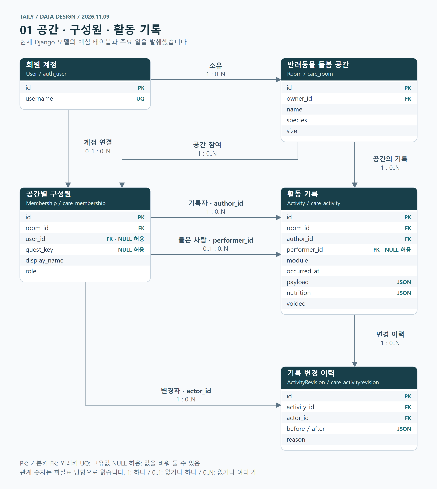
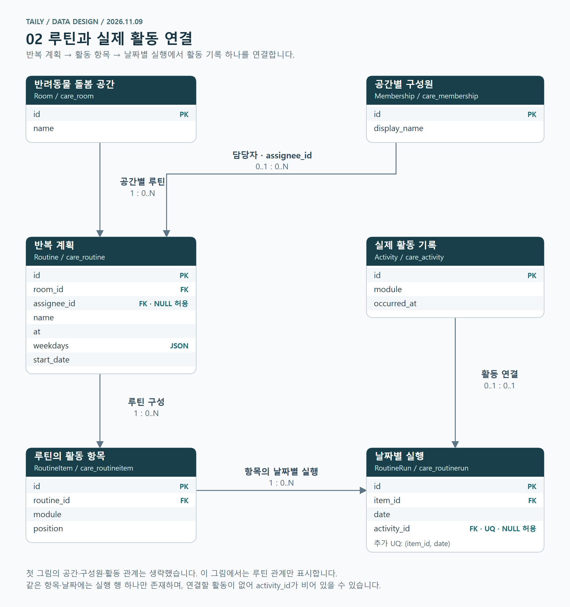

# [데이터 설계 02] 테일리 — ERD 초안과 AI 설계에서 고친 것

> 2026-11-09 · 데이터 설계 (4차 개선까지 마친 로컬 버전 기준)

테일리의 테이블과 열은 AI에게 맡겼다. 데이터베이스를 처음부터 직접 설계할 실력은 아직 없어서, 내가 정한 것은 "무엇을 한 단위로 볼지", "누가 참여하는지", "같은 기록을 몇 번 저장할지" 같은 큰 원칙이었다. 이 글에서는 그 원칙이 어떤 테이블이 됐는지, 사이트를 써 보면서 무엇을 고쳤는지, AI가 만든 구조에서 아직 남은 문제가 무엇인지 정리한다.

## 처음에 내가 정한 세 가지

첫 구현 전에 AI와 기능을 논의하면서 데이터에 영향을 주는 결정 세 가지를 먼저 정했다.

**1. 반려동물 한 마리가 하나의 방이다.** 혼자 쓰든 가족과 함께 쓰든, 기록은 반려동물 단위로 모인다. 그래서 반려동물 정보와 공유 공간을 따로 나누지 않고 `Room` 하나로 두었다. 이름, 종, 체격도 여기에 들어간다.

**2. 로그인과 권한은 별개다.** 내가 제안한 내용은 이랬다.

> 방을 만든 사람, 그 사람이 권한을 준 로그인한 사람, 링크로 들어온 게스트로 나누자. 초대받은 사람은 로그인 없이 기록할 수 있게 하되, 관리 권한을 받으려면 계정을 연결하게 하자.

AI는 이를 회원 계정(`User`)과 방별 구성원(`Membership`)으로 나눴다. 한 사람이 자기 방에서는 방장이고 다른 방에서는 게스트일 수 있기 때문이다. 게스트는 계정이 없으니 `user_id` 대신 `guest_key`로 구분한다.

이 결정은 화면에서 버튼을 숨기는 정도가 아니라 테이블 조건으로 들어갔다. 구성원 한 명은 계정과 게스트 식별자 중 정확히 하나만 가져야 하고, 게스트가 아닌 역할은 계정이 있어야만 저장된다. 방마다 방장은 한 명이다. "로그인만으로 관리자가 되지 않는다"는 말이 데이터 규칙이 된 셈이다.

**3. 같은 활동은 한 번만 저장한다.** 첫 글에서도 썼듯이, 루틴에서 저녁밥을 체크하고 식사 화면에서 또 기록하면 통계에 두 번 잡힌다. 그래서 모든 돌봄은 `Activity` 한 곳에 저장하고, 루틴이나 통계는 그 기록을 가져다 쓰게 했다.

## ERD 초안

아래 그림은 AI에게 현재 코드를 읽고 그리게 한 ERD다. 직접 만든 테이블은 18개인데, 설명에 필요한 것만 골랐다. 그림의 관계가 맞는지는 다른 AI에게 실제 모델 코드(`care/models.py`)와 하나씩 대조하게 했고, 틀린 곳은 없었다.

*[핵심 ERD 크게 보기](../assets/data-design/erd-core.png). PK는 각 행의 식별자, FK는 다른 테이블을 가리키는 열이다. 숫자는 화살표 방향으로 읽는다. `0..1`은 없거나 하나, `0..N`은 없거나 여러 개다.*

`Activity`에는 기록한 사람(`author_id`)과 실제로 돌본 사람(`performer_id`)이 따로 있다. 가족이 산책한 것을 내가 대신 입력할 수 있어서다. 어느 방에서 어떤 활동을 언제 했는지는 공통 열로 두고, 급여량이나 산책 거리처럼 활동마다 다른 값은 `payload`라는 JSON 열에 넣었다. 모듈이 20개라 모듈마다 테이블을 만들면 테이블이 20개 넘게 늘어나기 때문이다.

기록을 고치면 고치기 전과 후, 고친 사람, 이유를 `ActivityRevision`에 남긴다. 취소도 행을 지우지 않고 `voided` 표시만 한다. 공동 돌봄에서는 "누가 지웠는지 모르는 기록"이 가장 곤란하다고 봤다.

### 루틴과 실제 활동

루틴은 "매일 저녁 밥과 산책" 같은 반복 계획이고, 활동 기록은 그날 실제로 한 일이다. 둘을 섞지 않으려고 세 테이블로 나눴다.

| 테이블 | 역할 |
| --- | --- |
| `Routine` | 반복할 일정의 이름, 시각, 요일, 담당자 |
| `RoutineItem` | 그 일정에 들어 있는 식사·산책 같은 항목 |
| `RoutineRun` | 항목의 날짜별 실행과, 실제 활동 기록과의 연결 |

*[루틴 ERD 크게 보기](../assets/data-design/erd-routine.png). 첫 그림에 있는 관계는 생략했다. UQ는 중복을 허용하지 않는 조건이다.*

루틴에서 체크하면 활동 하나가 만들어지고 그날의 `RoutineRun`에 연결된다. 식사 화면에서 먼저 기록했다면 그 기록을 루틴에 연결할 수도 있다. 같은 항목과 날짜에는 실행 행이 하나만 생기고, 활동 하나는 실행 행 하나에만 연결된다. 그래서 어느 화면에서 시작하든 기록은 하나다. 기록을 취소하면 루틴 연결도 풀려서 루틴의 완료 표시가 같이 사라진다.

## 써 보고 고친 것

처음 구조가 그대로 끝까지 간 것은 아니다. 1차 사이트를 직접 써 보면서 지적한 내용 중 몇 가지는 화면이 아니라 테이블을 바꿨다.

### 기능을 켜는 것과 매일 보는 것은 다르다 (2차)

1차 구조에서 모듈 설정은 켜짐과 꺼짐, 순서뿐이었다. 켜 둔 모듈은 모두 화면에 나왔다. 그런데 청소나 미용은 몇 주에 한 번 하는 일이다.

> 청소나 미용처럼 자주 하지 않는 활동까지 매번 화면을 차지할 필요는 없다. 기능을 켜 두더라도 평소에는 숨기고, 설정한 간격이 됐을 때 보여주면 되지 않나?

같은 청소나 미용 모듈 안에서도 세부 활동마다 주기가 다를 수 있으니, 모듈 하나에 주기 하나로 묶지 말자고도 했다. 그래서 2차에서 두 가지가 바뀌었다. 모듈 설정(`ModuleSetting`)에 "오늘 화면에 고정" 열(`pinned`)이 따로 생겼고, 반복 주기를 담는 `CareCadence` 테이블이 새로 생겼다. 주기는 모듈 단위가 아니라 모듈 안의 세부 활동 단위로 저장되고, 같은 방에서 같은 세부 활동의 주기는 하나만 둘 수 있게 했다. 기존의 기능 사용 여부와 별개로, 오늘 화면 고정과 반복 주기를 설정할 수 있게 된 것이다.

### 품종을 고르면 체격을 제안한다 (3차)

처음에는 체격(소형·중형·대형)을 직접 고르게 했다. 3차 때 나는 개와 고양이 품종을 목록에서 고르면 체격이 자동으로 연결되고, 믹스나 품종 미상이면 직접 고르면 어떻겠냐고 제안했다. 다만 이건 예시였고, 실제 규칙은 자료를 찾아보고 정하라고 했다.

AI는 `Room`에 품종(`breed_key`)과 함께 "체격을 품종 자료로 제안받았는지, 직접 골랐는지"(`size_origin`)를 따로 저장했다. 제안을 고르면 품종과 성별 자료로 체격을 채우고, 직접 고르면 그 값을 그대로 쓴다. 내 제안과 다르게 정한 부분도 있었다. 체격 구분은 개에만 쓰고, 고양이는 품종만 저장하고 체격은 비워 둔다. 성장 상태(`maturity`)도 함께 넣었는데, 다 자랐다고 확인한 경우에만 성견·성묘 체중 자료와 비교하기 위해서다. `size_origin`과 `maturity`는 내가 요청한 것이 아니라 AI가 판단해서 추가한 열이다.

### 정리용 묶음과 분석은 따로 (3차)

모듈이 20개나 되니 사용자가 이름을 붙여 직접 묶을 수 있게 하자고 했다. 동시에, 사용자가 묶음 이름이나 순서를 바꿨다고 통합 상태의 분석 결과가 달라지면 안 된다고 했다.

그래서 저장 위치를 나눴다. 사용자가 만드는 묶음은 `ModuleGroup` 테이블에 저장하고, 분석에 쓰는 기본 분류(먹이·체중, 활동·휴식, 상태·건강, 생활·환경)는 테이블이 아니라 코드에 고정했다. 사용자가 바꿀 수 있는 것과 분석 기준이 아예 다른 곳에 있으니 섞일 일이 없다.

### 화면이 바뀌어도 테이블은 그대로 (4차)

4차에서는 전체 기록을 날짜순에서 분류 중심으로 바꾸고, 분류 안에서 모듈을 바로 넣고 빼게 했다. 화면은 크게 바뀌었지만 테이블은 하나도 바뀌지 않았다. 모듈을 빼는 것은 `ModuleSetting`의 켜짐 값을 끄는 것뿐이고, 과거 활동 기록은 그대로 남는다. 처음에 기록을 `Activity` 한 곳에 모아 둔 덕분에 화면 쪽 변경이 데이터까지 번지지 않았다.

## AI가 만든 구조에서 남은 문제

AI가 만든 구조를 그대로 믿지 않으려고, 다른 AI에게 실제 코드와 대조해 약점을 찾게 했다. 아래는 **AI가 찾은 문제**이고, 편하게 만든 대신 생긴 약점들이다.

- **JSON 안의 값은 데이터베이스가 검사하지 않는다.** `payload`에 들어가는 급여량, 거리, 단위가 맞는지는 저장하는 코드가 확인해야 한다. 코드에서 빠뜨리면 이상한 값이 그대로 저장된다.
- **제품 연결이 FK가 아니다.** 어떤 사료를 먹였는지는 `payload` 안의 제품 식별자로만 남는다. 제품 테이블과 직접 연결되지 않아서, 제품을 지웠을 때 데이터베이스가 막아 주지 않는다. 대신 기록할 때의 제품 영양 정보를 `nutrition`에 복사해 두어서, 나중에 제품 정보를 고쳐도 과거 칼로리 계산은 바뀌지 않는다.
- **방장 정보가 두 곳에 있다.** `Room.owner_id`에도 방장이 있고, `Membership`의 역할에도 방장이 있다. 지금은 방을 만들 때 둘을 같이 저장하고, 방장 권한을 확인할 때도 둘 다 본다. 하지만 같은 사실을 두 번 저장한 것이라, 나중에 방장을 넘기는 기능을 만들면 두 곳을 반드시 같이 바꿔야 한다. 수업에서 배운 정규화 관점에서는 고칠 거리다.
- **같은 일을 두 사람이 따로 기록하면 못 막는다.** 저장 버튼을 두 번 누르는 것은 요청마다 붙는 식별자(`client_key`)로 걸러진다. 하지만 두 사람이 같은 저녁밥을 각자 새로 기록하면 서로 다른 기록 두 개가 된다. 처음에 "같은 활동은 한 번만 저장한다"고 정했지만, 데이터베이스가 지켜 주는 것은 한 사람의 중복 저장과 루틴 연결까지다.

## 통합 상태에서 막힌 것

통합 상태(지금 화면 이름은 '최근 변화')는 써 볼 때마다 뭔가 맞지 않는다는 느낌이 있었다. 그런데 무엇이 문제인지 말로 정리하기가 어려웠다. 그래서 AI에게 통합 상태의 코드와 데이터를 전체적으로 살펴보고 문제를 찾게 했다. 아래 목록은 **AI가 찾은 문제**다. 이 목록과 별개로 내가 느낀 점은 마지막에 따로 적었다.

### AI가 찾은 문제: 데이터 구조에서 생긴 것

1. **분석이 JSON 안의 이름에 기대고 있다.** 통합 분석은 `payload` 안의 이름을 직접 꺼내 쓴다. 체중은 `weight`, 산책 시간은 `minutes` 같은 식이다. 입력 칸 이름이 바뀌어도 데이터베이스는 오류 없이 저장하고, 그 기록은 분석에서 조용히 빠진다.
2. **열량은 사료 정보를 등록해야만 계산된다.** 기록할 때 사료를 고르지 않으면 열량이 비어 있다. 게다가 하루 식사 중 하나라도 열량이 없으면 그날 열량은 통째로 빠진다. 실제로 쓰면 열량 비교가 거의 안 나올 수 있다.
3. **두 사람이 같은 밥을 따로 기록하면 하루 합계가 두 배가 된다.** 앞에서 적은 중복 기록 문제가 통합 상태에서는 "식사량이 늘었다"로 읽힌다.

### AI가 찾은 문제: 분석 범위와 검증

4. **20개 기능 중 숫자로 분석하는 것은 8개뿐이다.** 체중, 식사, 간식, 실측한 물, 산책, 놀이, 훈련, 수면이다. 배변, 투약, 병원 같은 나머지는 종합 판단에 숫자로 들어가지 않는다. 처음에 원한 "여러 기록을 함께 보는 종합 상태"에 비하면 일부만 보고 있다.
5. **수치를 비교하려면 기록이 쌓여야 한다.** 최근 7일과 그 앞 28일을 비교하는데, 두 구간 안에 각각 최근 3일, 이전 7일 이상의 기록이 있어야 한다. 체중은 최근 2일, 이전 3일이다. 이 조건을 채우기 전에는 수치 비교가 제한된다. 다만 평소와 다르다고 남긴 관찰은 하루만 기록해도 따로 표시된다.
6. **기록 습관이 바뀐 것과 상태가 바뀐 것을 확실히 구분하지 못한다.** 기록하는 종류나 하루 기록 횟수가 크게 달라지면 따로 표시하지만, 어디까지나 추정이다.
7. **공통 계산과 4차에서 추가한 처리를 나눠 확인해야 한다.** 현재 화면은 `assessment.assess()`를 거쳐 기존 `patterns.analyze()`의 계산을 사용한다. 사용하지 않는 옛 코드가 남아 있는 것은 아니다. 기존 테스트는 공통 계산을 확인하고, 별도 4차 테스트는 기록 방식 변화나 변화 날짜의 겹침처럼 추가한 처리를 확인한다. 기존 테스트만 통과했다고 4차 결과까지 모두 확인한 것으로 볼 수는 없다.
8. **실제 보호자의 장기 기록으로 분석이 얼마나 유용한지는 확인하지 못했다.** 변화를 판단하는 기준값은 설계상 정한 값이다. 가상 시연 예시 여섯 개 외에 별도 자동검사도 있지만, 정해 둔 계산과 동작이 맞는지 확인하는 검사다. 실제로 오래 사용했을 때 상태 파악에 도움이 되는지는 아직 확인이 필요하다.

### 내 생각

AI가 찾은 문제는 대부분 계산과 데이터 쪽이었다. 내가 통합 상태를 볼 때 먼저 걸린 것은 화면이었다. 사용자는 몰라도 되는 이론과 공식, 수학 용어가 화면에 튀어나와 있고, 전체적으로 딱딱해서 눈에 잘 들어오지 않았다.

이것저것 찾아보다가 삼성 헬스 앱의 화면이 괜찮아 보였다. 처음에는 통합 상태 화면만 손보면 된다고 생각했는데, 생각해 보니 통합 상태만의 문제가 아니었다. 그래서 앞으로 삼성 헬스의 화면 구성을 참고해 사이트 전체 디자인을 다시 정리해 볼 생각이다.

## 정리와 다음 단계

테이블과 열을 직접 짠 것은 AI다. 내가 한 일은 처음에 원칙 세 가지를 정하고, 써 보면서 "켜는 것과 보는 것은 다르다", "묶음을 바꿔도 분석은 그대로여야 한다"처럼 요구를 구체적으로 짚은 것이다. 그 요구가 `pinned`, `CareCadence`, `ModuleGroup` 같은 실제 변경으로 이어졌다. 반대로 `size_origin`처럼 AI가 먼저 챙긴 부분도 있었고, 방장 정보 중복처럼 AI가 놓친 부분도 있었다.

이 글은 AI가 작성한 초안에 내 생각을 보태고, Claude와 함께 내용을 고쳤다.

지금까지는 내 컴퓨터에서만 돌려 봤다. 다음 단계는 첫 배포다. 외부 주소에서 기록을 넣고 다시 볼 수 있게 만드는 것이 목표다.
